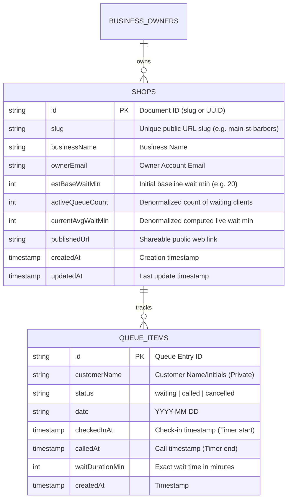

# WaitLink - Architecture & Design Specification

WaitLink is an ultra-lightweight, high-aesthetic, single-page SaaS web application designed for walk-in businesses (barbershops, urgent care clinics, pet groomers, auto shops). 

It empowers front-desk staff with a **1-tap check-in & call workflow**, while publishing a privacy-friendly, real-time **live wait time link** for customers and social media.

---

## 1. Google Cloud & Firebase Setup

### Project Creation Step-by-Step
1. **Google Cloud Console**:
   - Create Project: `waitlink-prod`
   - Region: `us-central1`
2. **Enable Firebase & Firestore API**:
   - Database Mode: **Firestore Native Mode**
   - Location: `nam5` (us-central)

### Firestore Security Rules
```javascript
rules_version = '2';
service cloud.firestore {
  match /databases/{database}/documents {
    
    // Public shop document (contains ONLY average metrics, NO customer names)
    match /shops/{shopId} {
      allow read: if true; // Publicly accessible for live wait link
      allow write: if request.auth != null && request.auth.uid == resource.data.ownerId;
    }
    
    // Private queue collection (Desk access ONLY)
    match /shops/{shopId}/queue/{queueId} {
      allow read, write: if request.auth != null;
    }
  }
}
```

---

## 2. Firestore Data Model & Collection Schema



### Collection 1: `shops` (Business Profile & Published Links)
*Path: `/shops/{shopId}`*

| Field Name | Type | Description |
| :--- | :--- | :--- |
| `slug` | `string` | Unique slug used in the shareable link (`waitlink.app/s/main-st-barbers`). |
| `businessName` | `string` | Business name displayed on desk and public pages. |
| `ownerEmail` | `string` | Owner email for authentication & management. |
| `estBaseWaitMin` | `number` | Fallback wait time before 3+ completed visits today (e.g., `20`). |
| `activeQueueCount` | `number` | Real-time counter of customers currently `waiting`. |
| `currentAvgWaitMin` | `number` | Rolling average of wait times for recent calls today. |
| `publishedUrl` | `string` | Full shareable URL. |
| `createdAt` | `timestamp` | Account creation date. |
| `updatedAt` | `timestamp` | Last activity date. |

### Collection 2: `shops/{shopId}/queue` (Private Desk Queue Items)
*Path: `/shops/{shopId}/queue/{queueId}`*

| Field Name | Type | Description |
| :--- | :--- | :--- |
| `customerName` | `string` | First name or initials entered by desk (e.g. `"David S."`). |
| `status` | `string` | Status enum: `'waiting'` \| `'called'` \| `'cancelled'`. |
| `date` | `string` | Daily partition string `YYYY-MM-DD`. |
| `checkedInAt` | `timestamp` | When desk hit **Check In** (starts timer). |
| `calledAt` | `timestamp` | When desk hit **Call** (ends timer). |
| `waitDurationMin` | `number` | Calculated duration `(calledAt - checkedInAt)` in minutes. |
| `createdAt` | `timestamp` | Document creation timestamp. |

---

## 3. Real-Time Calculation Engine

### Rolling Average Wait Formula
When desk staff taps **Call**, the system calculates the live wait time:

$$\text{Current Live Wait} = \frac{\sum_{i=1}^{N} \text{WaitDuration}_i}{N} + (\text{ActiveQueueCount} \times \text{AvgServiceTime})$$

* Where $N$ is the rolling window of the last 5 served customers today.
* If $N < 3$, the system smoothly blends with `estBaseWaitMin`.

---

## 4. Single-Page Web App Architecture

The app is built as a single-page application (SPA) with **3 integrated views**:

1. **Desk View (Default Operative Mode)**:
   * Quick-add customer input (`Enter` key checks in).
   * Live queue cards with real-time ticking counters (`05:22 min`).
   * One-tap `[ ⏱️ SERVE NOW / SERVE NEXT ]` and `[ ✕ Cancel ]` buttons.
   * Automated Twilio SMS dispatch: Sends an instant turn-ready text message containing the customer's live ticket tracking link (`https://waitlink.app?s=slug&view=public&ticket=id`).
   * Stats bar showing: **Live Est. Wait**, **In Line**, **Served Today**.

2. **Public View Mode (Live Customer Link)**:
   * Clean, glowing dark-mode interface with zero customer login required.
   * Displays: **Estimated Wait Time** & **People in Line**.
   * Completely anonymous — zero names published.

3. **Printable Window QR Poster & Settings Modal**:
   * Generates a sleek printable window poster with an embedded QR code leading to the public link.

---

## 5. Technology Stack & Key Highlights
* **Frontend**: HTML5, Vanilla JavaScript (ES6 Modules), CSS3 (Custom Glassmorphism + Responsive Variables).
* **Database**: Google Cloud Firestore with real-time snapshot listeners (`onSnapshot`).
* **Icons & Styling**: Inter & Outfit fonts, SVG vector graphics, micro-animations.
* **Deployment**: Firebase Hosting or Cloud Run.
