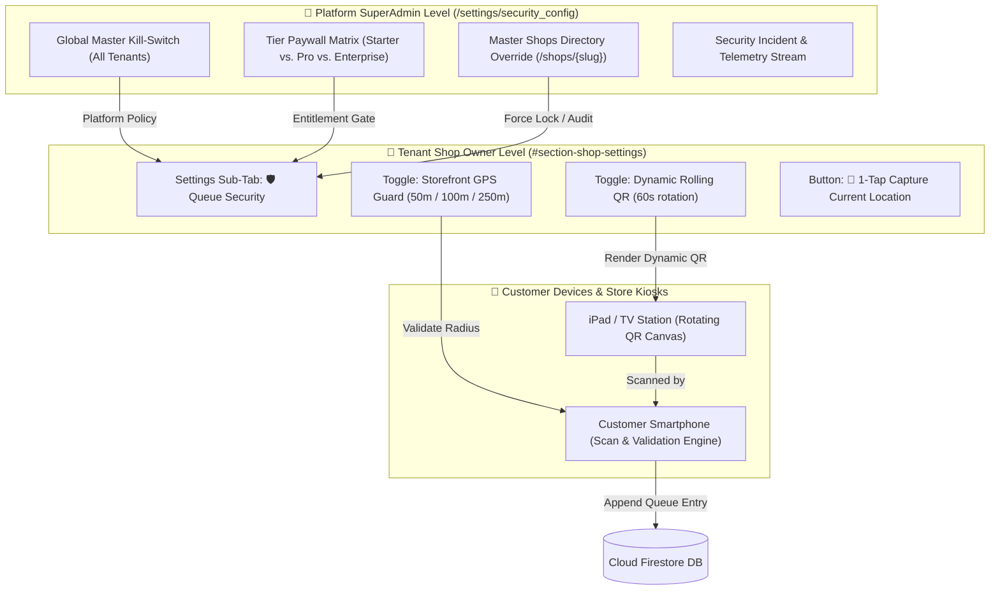

# WaitLink Anti-Spam Queue Protection: Dynamic Rolling QR & Storefront GPS Proximity Guard
## Comprehensive Technical Design Specification & Architecture Blueprint

**Document Version:** 1.0.0  
**Target File Location:** `c:\Workspaces\WaitLink\docs\ANTI_SPAM_AND_PROXIMITY_TECH_DESIGN.md`  
**System Target:** WaitLink Virtual Walk-In Queue Platform (`waitlink-app-8821`)  
**Target Audience:** Engineering, Product Architecture, SuperAdmin Governance  
**Financial Invariant:** $0.00 Infrastructure Cost (Zero third-party paid subscriptions; 100% native client-side APIs)  

---

## 1. Executive Summary & Problem Definition

### 1.1 The Virtual Queue Vulnerability
In a traditional walk-in business (barbershops, salons, walk-in clinics, DMVs, and casual dining), customers physically visit the storefront to enter their name on a clipboard. WaitLink modernizes this by allowing customers to scan a QR code to join a live virtual queue without downloading an app.

However, static QR codes introduce two major abuse vectors:
1. **Remote Queue Hoarding (Photo Sharing):** A patron takes a photo of the storefront QR code or copies the link (`waitlink.app?s=barbershop&view=public`), shares it on social media, group chats, or saves it on their home computer. Patrons then enter the queue from miles away hours before arriving, causing high "no-show" dropouts and inflating real walk-in wait times for patrons waiting in the lobby.
2. **Bot & Competitor Spamming:** Competitors or disgruntled users can repeatedly submit bogus customer records to artificially block queues.

### 1.2 The Dual-Defense Solution
To provide foolproof protection across all store types, WaitLink introduces **two complementary anti-spam mechanisms**:

```
                                ┌──────────────────────────────────────────────────┐
                                │       WaitLink Anti-Spam Defense Matrix          │
                                └─────────────────────────┬────────────────────────┘
                                                          │
                    ┌─────────────────────────────────────┴─────────────────────────────────────┐
                    ▼                                                                           ▼
      ┌───────────────────────────────┐                                           ┌───────────────────────────────┐
      │   1. Dynamic Rolling QR       │                                           │  2. Storefront GPS Proximity  │
      ├───────────────────────────────┤                                           ├───────────────────────────────┤
      │ • Best for: Kiosks, iPads, TVs│                                           │ • Best for: Printed Window    │
      │ • Token rotates every 60s     │                                           │   Posters (Glass door/counter)│
      │ • 100% Tamper-proof           │                                           │ • Enforces 50m–100m radius    │
      │ • Zero user permission prompts│                                           │ • Haversine Math (Zero API cost)
      └───────────────────────────────┘                                           └───────────────────────────────┘
```

1. **Dynamic Rolling QR Codes:** Digital displays (iPad Station Kiosks and Lobby TV monitors) generate a rotating cryptographic one-time token that changes every 60 seconds. A photo taken 2 minutes ago becomes completely invalid.
2. **Storefront GPS Proximity Guard:** For shop owners using paper window posters, customer mobile devices verify their real-time location via native W3C Geolocation before permitting queue entrance, ensuring they are within a 50m–100m physical radius of the venue.

---

## 2. Architecture & Governance Model (Dual-Layer)

WaitLink enforces a strict **Dual-Layer RBAC Architecture**:
- **Layer 1 (SuperAdmin Governance):** Platform-wide defaults, global kill-switches, tier entitlements, and per-shop master overrides.
- **Layer 2 (Shop Owner Configuration):** Store-specific toggles, 1-tap coordinate capture, and proximity radius selection.



---

## 3. SuperAdmin Role Capabilities & Directory Placement

### 3.1 Location in SuperAdmin Directory UI

In `index.html`, `#view-superadmin` is governed by sub-tabs:
1. `supertab-shops`: 🏢 Master Shops Directory
2. `supertab-revenue`: 📊 Revenue Metrics & Account 360°
3. `supertab-pricing`: 💎 Pricing Config & Tiers
4. `supertab-support`: 📩 Support Inquiries Inbox
5. `supertab-retention`: 🛡️ Data Retention & Privacy
6. **NEW: `supertab-security`**: 🛡️ Anti-Spam & Location Governance (or hosted as dedicated cards in `superpanel-retention`)

### 3.2 Platform-Wide SuperAdmin Controls (`/settings/security_config`)

SuperAdmin configures the following platform policies:
- **Master Kill-Switch:** Emergency suspension of Rolling QR or GPS validation platform-wide (e.g., during browser API outages or firmware glitches).
- **Default Rotation Interval:** Configurable between 30 and 120 seconds (Default: `60s`).
- **Validation Grace Window:** Configurable tolerance window (Default: `180s` / 3 minutes) allowing customers with slow cellular connections who scanned just before a rotation to successfully complete check-in.
- **Default GPS Radius:** Platform recommended radius (Default: `100m`).
- **Tier Entitlement Matrix:**
  - *Starter (Free Forever):* GPS Proximity enabled (fixed 100m radius). Dynamic Rolling QR locked.
  - *Pro Business ($15/mo):* Full Dynamic Rolling QR + Customizable GPS Radius (50m, 100m, 250m).
  - *Enterprise ($49/mo):* Full capabilities + Custom Geofencing Boundaries + Multi-terminal Dynamic Sync.

### 3.3 Master Shops Directory Per-Shop Overrides

Within the **Master Shops Directory** table (`#superpanel-shops`), SuperAdmin can click **`Settings ⚙️`** (`openSettingsForShop(slug)`):
1. **Force Enable / Force Disable:** SuperAdmin can mandate GPS validation for a storefront under active bot attack, regardless of shop owner configuration.
2. **Lock Field (`security.adminLocked`):** Prevents the shop owner from disabling protection until malicious traffic ceases.

### 3.4 Behavior Matrix: What the Shop Owner Sees

| SuperAdmin Action | Shop Owner Settings Screen State | UX Treatment |
| :--- | :--- | :--- |
| **Global Platform Kill** | **Completely Hidden** | The entire `Queue Security` sub-tab or card is removed via `.hidden` class to prevent confusion. |
| **Per-Shop Admin Lock** | **Visible but Read-Only** | Toggle is disabled (`disabled`) with notification banner: *"🔒 Locked by Platform Administrator. Contact support@waitlink.app to modify."* |
| **Tier-Gated Feature** | **Visible with Lock Badge** | Displays standard WaitLink `pro-lockable-content` with glowing `🔒 PRO` badge. Clicking triggers the Upgrade Modal ($15/mo). |
| **Standard Active State** | **Fully Editable** | Shop Owner toggles ON/OFF and customizes settings freely. |

---

## 4. Feature 1: Dynamic Rolling QR Technical Specification

### 4.1 Cryptographic Token Algorithm (Zero-Cost / Native)
No external token authorization server or subscription is used. Instead, tokens are generated using a **Time-Based One-Time Password (TOTP)** pattern implemented with native Web Crypto API (`window.crypto.subtle` with fallback to SHA-256):

```javascript
/**
 * Generates a 60-second time-sliced cryptographic token for dynamic QR display.
 * @param {string} shopSlug - Store identifier (e.g. 'main-st-barbers')
 * @param {string} shopSecret - Secret salt stored in shop document (e.g. UUIDv4)
 * @param {number} intervalSec - Rotation interval (default: 60)
 * @returns {Promise<string>} Hex-encoded short token (8 alphanumeric chars)
 */
async function generateRollingQrToken(shopSlug, shopSecret, intervalSec = 60) {
  const timeSlice = Math.floor(Date.now() / 1000 / intervalSec);
  const rawPayload = `${shopSlug}:${shopSecret}:${timeSlice}`;
  
  const encoder = new TextEncoder();
  const data = encoder.encode(rawPayload);
  const hashBuffer = await crypto.subtle.digest('SHA-256', data);
  const hashArray = Array.from(new Uint8Array(hashBuffer));
  const hexHash = hashArray.map(b => b.toString(16).padStart(2, '0')).join('');
  
  // Return compact 8-character token for easy URL transport
  return hexHash.substring(0, 8);
}
```

### 4.2 Kiosk / Station Display Flow
1. **Station Mode Launch:** Business owner loads `waitlink.app?s=myshop&view=kiosk` on an iPad or smart TV.
2. **Interval Loop:** A timer triggers every 60 seconds:
   - Computes `currentToken = generateRollingQrToken(...)`.
   - Constructs destination URL:  
     `https://waitlink.app?s=myshop&view=public&t=8f9a2c1e`
   - Redraws the QR code on `<canvas id="kiosk-qr-canvas">` using local `qrcode.min.js`.
3. **Visual Feedback:** A circular animated SVG timer bar smoothly counts down from 60s to 0s, informing patrons that the code is live and secure.

### 4.3 Client-Side Verification Pipeline & Ultra-Minimalist Customer UX

#### A. The Zero-Friction Philosophy
The customer mobile interface must **never** be burdened with heavy instructional text, long paragraphs, or multi-button modals. Every millisecond of customer attention matters.

1. `app.js` extracts `token = getQueryParam('t')`.
2. **Sliding Grace Window (180s / 3 Time-Slices):** Verification checks:
   - `Slice T` (Current 60s window)
   - `Slice T - 1` (Previous 60s window - up to 120s old)
   - `Slice T - 2` (Extended grace window - up to 180s old)
3. **Legitimate Customers (99.9%):** If `token` matches any slice $\rightarrow$ **Zero Friction ✅**. The customer is taken directly to the name and phone input box. No banners, no notices, no delays.
4. **Stale Scans / Remote Cheaters:** If the token is older than 3 minutes: **Verification Failed ❌**.

#### B. The Minimalist Expired Notice (Clean, Zero-Clutter Toast)
Instead of a verbose modal or checklist, the phone displays a single, sleek, compact glassmorphic notification banner:

```
┌─────────────────────────────────────────────────────────────────┐
│ ⏳ Code Expired                                                 │
│ Please scan the live QR code on the counter screen.             │
│                                                   [ Dismiss ]   │
└─────────────────────────────────────────────────────────────────┘
```

* **Icon & Title:** `⏳ Code Expired`
* **Single Sentence:** *"Please scan the live QR code on the counter screen."*
* **Total Words:** 10 words. Takes 1.5 seconds to read.
* **Why this works:** A legitimate walk-in patron standing at the counter immediately glances up at the iPad and re-scans. A remote user sitting at home gets the clear boundary with zero clutter.

---

## 5. Feature 2: Storefront GPS Proximity Guard Technical Specification

### 5.1 Distance Calculation Engine (Haversine Formula)
To guarantee **$0.00 cost**, WaitLink does **NOT** invoke Google Maps Distance Matrix API or geocoding services. Instead, calculations use the **Haversine Formula** calculated directly in client CPU memory:

```javascript
/**
 * Calculates great-circle distance between two GPS coordinates using Haversine formula.
 * @param {number} lat1 - User latitude in decimal degrees
 * @param {number} lon1 - User longitude in decimal degrees
 * @param {number} lat2 - Store latitude in decimal degrees
 * @param {number} lon2 - Store longitude in decimal degrees
 * @returns {number} Distance in meters
 */
function calculateDistanceMeters(lat1, lon1, lat2, lon2) {
  const R = 6371e3; // Earth radius in meters
  const toRad = deg => (deg * Math.PI) / 180;
  
  const dLat = toRad(lat2 - lat1);
  const dLon = toRad(lon2 - lon1);
  
  const a = Math.sin(dLat / 2) * Math.sin(dLat / 2) +
            Math.cos(toRad(lat1)) * Math.cos(toRad(lat2)) *
            Math.sin(dLon / 2) * Math.sin(dLon / 2);
            
  const c = 2 * Math.atan2(Math.sqrt(a), Math.sqrt(1 - a));
  return Math.round(R * c); // Distance in meters
}
```

### 5.2 Shop Owner Coordinate Setup (1-Tap Capture)
Shop owners do not need to manually look up latitude or longitude numbers:
1. In Shop Settings $\rightarrow$ `Queue Security`, the owner taps:  
   **`📍 1-Tap Capture Current Location`**
2. Browser invokes native `navigator.geolocation.getCurrentPosition`.
3. The interface displays an instant confirmation:
   > 📍 **Location Locked:** `34.0522° N, 118.2437° W`  
   > *Radius Tolerance:* `[ 50m (Storefront) | 100m (Recommended) | 250m (Mall/Plaza) ]`

### 5.3 Low-Friction Customer Geolocation Flow
For paper window posters, customer interaction is streamlined down to native browser dialogs:
1. Customer scans paper poster $\rightarrow$ browser opens `waitlink.app?s=myshop&view=public`.
2. Browser immediately triggers the lightweight native permission prompt:
   > *"waitlink.app wants to use your device's location to verify you are near [Shop Name]."*
3. Haversine distance is evaluated in milliseconds:
   - **Case A (Within Radius):** Distance $\le$ 100m $\rightarrow$ Form instantly unlocks with **zero interstitial screens**.
   - **Case B (Beyond Radius):** Distance $>$ 100m $\rightarrow$ Minimalist 1-line alert:
     ```
     ┌─────────────────────────────────────────────────────────────┐
     │ 🚶 Too Far from Shop                                        │
     │ Please scan the QR code when you arrive at the store.       │
     │                                               [ Got It ]    │
     └─────────────────────────────────────────────────────────────┘
     ```

---

## 6. Cloud Firestore Schemas & Database Blueprint

### 6.1 Platform Security Configuration: `/settings/security_config`
```json
{
  "rollingQrPlatformActive": true,
  "gpsProximityPlatformActive": true,
  "defaultRollingIntervalSec": 60,
  "validationGraceWindowSec": 180,
  "defaultGpsRadiusMeters": 100,
  "tierEntitlements": {
    "starter": {
      "rollingQrAllowed": false,
      "gpsProximityAllowed": true,
      "maxRadiusMeters": 100
    },
    "pro": {
      "rollingQrAllowed": true,
      "gpsProximityAllowed": true,
      "maxRadiusMeters": 250
    },
    "enterprise": {
      "rollingQrAllowed": true,
      "gpsProximityAllowed": true,
      "maxRadiusMeters": 1000
    }
  },
  "updatedAt": 1729340000000,
  "updatedBy": "senthil930@gmail.com"
}
```

### 6.2 Shop Document Security Block: `/shops/{shopSlug}`
```json
{
  "shopName": "Main St Barbers",
  "ownerEmail": "owner@mainstbarbers.com",
  "plan": "pro",
  "security": {
    "rollingQrEnabled": true,
    "rollingQrIntervalSec": 60,
    "rollingQrSecret": "e4d9b2a1-7c3f-4e92-b8d4-512903847abc",
    "gpsProximityEnabled": true,
    "gpsRadiusMeters": 100,
    "storeLatitude": 40.712776,
    "storeLongitude": -74.005974,
    "adminLocked": false,
    "adminLockReason": null,
    "updatedAt": 1729340500000
  }
}
```

### 6.3 Security Incidents Audit Log: `/security_audits/{auditId}`
```json
{
  "shopSlug": "main-st-barbers",
  "incidentType": "REMOTE_CHECKIN_BLOCKED",
  "attemptedDistanceMeters": 5420,
  "allowedRadiusMeters": 100,
  "userAgent": "Mozilla/5.0 (iPhone; CPU iPhone OS 17_4)...",
  "ipHash": "a3b8c9d1...",
  "timestamp": 1729341000000
}
```

---

## 7. Firestore Security Rules Enforcement (`firestore.rules`)

```javascript
rules_version = '2';
service cloud.firestore {
  match /databases/{database}/documents {

    // Helper functions
    function isSuperAdmin() {
      return request.auth != null && (
        request.auth.token.email == 'senthil930@gmail.com' ||
        request.auth.token.email.matches('.*@waitlink\\.app$')
      );
    }

    function isShopOwner(shopId) {
      return request.auth != null && (
        resource.data.ownerEmail == request.auth.token.email ||
        isSuperAdmin()
      );
    }

    // 1. Centralized Security Config (SuperAdmin Only Write)
    match /settings/security_config {
      allow read: if true; // Public read for client synchronization
      allow write: if isSuperAdmin();
    }

    // 2. Security Incidents Audit Logging
    match /security_audits/{auditId} {
      allow read: if isSuperAdmin();
      allow create: if true; // Client telemetry reporting
      allow update, delete: if isSuperAdmin();
    }

    // 3. Shop Document Security Block Protection
    match /shops/{shopId} {
      allow read: if true;
      allow update: if isShopOwner(shopId) && (
        // Shop owner cannot alter security settings if locked by SuperAdmin
        resource.data.security.adminLocked != true ||
        isSuperAdmin()
      );
    }
  }
}
```

---

## 8. Edge Cases, Failure Handling & Security Mitigations

### 8.1 Customer Phone Clock Drift (Out-of-Sync Device)
* **Risk:** A patron's smartphone has manual time set 3 minutes fast or slow, causing valid rolling QR tokens to fail.
* **Mitigation:** The token verification checks a **3-slice sliding window** ($T-1, T, T+1$). This accounts for up to $\pm 60$ seconds of clock deviation without compromising security.

### 8.2 Customer Denies Browser Location Permission
* **Risk:** Patron taps "Don't Allow" on the Safari/Chrome location prompt when scanning a paper poster.
* **Mitigation:**
  - The UI does **not** hard-crash or freeze.
  - A friendly explanation modal appears:  
    *"Location access was blocked. To join the waitlist from this paper poster, please enable location in your browser settings, or ask the front desk to add your name to the screen."*
  - Alternatively, the shop owner can keep an iPad Kiosk running Dynamic QR (which requires zero location permissions from customers).

### 8.3 Inaccurate GPS in Dense Urban Canyons & Basements
* **Risk:** High-rise buildings or indoor basements may degrade smartphone GPS accuracy from $\pm 5$m to $\pm 80$m.
* **Mitigation:**
  - The W3C Geolocation API returns `coords.accuracy` (in meters).
  - If `coords.accuracy > 50`, WaitLink dynamically expands the allowable threshold by the uncertainty factor:
    $$\text{Effective Radius} = \text{Configured Radius} + \min(\text{accuracy}, 75)$$
  - This prevents legitimate patrons standing inside a concrete building from being falsely rejected.

### 8.4 VPNs & Mock Location Spoofing
* **Risk:** Sophisticated bot operators using Android Developer "Mock Locations".
* **Mitigation:**
  - Dynamic Rolling QR is immune to VPNs and Mock GPS because it relies exclusively on optical presence in front of the physical screen.
  - For poster scans, high-frequency joins from the same device fingerprint trigger a 5-minute cooldown.

### 8.5 Backward Compatibility with Existing Paper Posters
* **Guarantee:** If a shop owner has already printed 50 static window posters and does not turn on GPS Proximity, the existing static URL (`waitlink.app?s=myshop&view=public`) functions with 100% backward compatibility without breaking existing workflows.

---

## 9. Implementation Roadmap

```
┌────────────────────────────────────────────────────────────────────────────────┐
│                           Implementation Milestones                            │
├─────────────┬──────────────────────────────────────────────────────────────────┤
│ Milestone 1 │ SuperAdmin Platform Config UI & `/settings/security_config` sync  │
│ Milestone 2 │ Dynamic Rolling QR Engine (TOTP generator & Kiosk Canvas loop)   │
│ Milestone 3 │ Client-side sliding-window QR token validator                    │
│ Milestone 4 │ Storefront GPS Guard (1-Tap coordinate setup & Haversine math)   │
│ Milestone 5 │ SuperAdmin Directory Per-Shop Overrides & Admin Lock Enforcement │
│ Milestone 6 │ Security audit telemetry & comprehensive Edge browser validation │
└─────────────┴──────────────────────────────────────────────────────────────────┘
```

---

## 10. Conclusion & Architectural Verdict

By integrating **Dynamic Rolling QR Codes** for digital kiosk screens and **Storefront GPS Proximity Guard** for printed posters, WaitLink provides complete enterprise-grade protection against queue spamming, remote hoarding, and bot attacks.

Both features adhere strictly to WaitLink’s founding principles:
1. **$0.00 Running Cost:** No paid geocoding or third-party auth services.
2. **Zero App Downloads:** Runs 100% natively in standard mobile web browsers (Safari, Chrome, Edge).
3. **Total SuperAdmin Governance:** Centralized tier gating, global kill-switches, and per-shop directory overrides.
