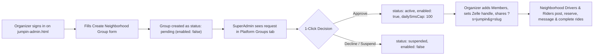

# JumpIn Multi-Neighborhood Group System — UX & Technical Design

**Document:** `docs/CARPOOL_JUMPIN_MULTI_GROUP_DESIGN.md`  
**Status:** Proposed Architecture (Hybrid: Self-Serve Request + 1-Click SuperAdmin Approval)  
**Scope:** Multi-tenant neighborhood carpool groups for `WaitLink JumpIn`

---

## 1. Overview & Goals

Currently, JumpIn operates as a single global community board (`carpool_public/root/rides`, `carpool_private/*`, `settings/carpool_config`). To allow **many neighborhoods, schools, temples, or apartment communities** to run their own isolated carpool boards with their own members, settings, and Zelle/Venmo tip handles, JumpIn will adopt a **multi-tenant group architecture** keyed by `groupId` (URL parameter `g=<slug>`).

### Key Design Principles
1. **Hybrid Onboarding (Recommended):** Any organizer can sign in with Google and submit a **Create Neighborhood Group** form. The group starts in `pending` (`enabled: false`, `0` SMS budget) until the Platform SuperAdmin approves it in **1 click**. This prevents spam/SMS abuse while keeping organizer onboarding self-serve.
2. **Strict Tenant Isolation:** Each neighborhood's trips, reservations, members, blocked numbers, settings, and support handles are completely isolated. Neighborhood admins can only manage their own group.
3. **100% Backward Compatible:** Omitting `?g=` resolves to `groupId = "default"`, preserving all existing WaitLink JumpIn links and rides.
4. **Atomic & Race-Condition Free:** Group creation (slug reservation), seat bookings, completions, and SMS budget accounting all run inside Firestore transactions via `adaptFirestore`.

---

## 2. URL Routing & Entry Points

| Audience | URL Format | Behavior |
| --- | --- | --- |
| **Default / Legacy Link** | `https://waitlink.app/?s=jumpin` | Loads `groupId = "default"` (or prompts returning user with 1-tap shortcut to their last visited group). |
| **Neighborhood Board** | `https://waitlink.app/?s=jumpin&g=ballantyne` | Loads the live ride board, branding, and Zelle/Venmo support card for `ballantyne`. |
| **Neighborhood Ride Page** | `https://waitlink.app/?s=jumpin&g=ballantyne&view=ride&ride=ride_123` | Opens the ride inside the `ballantyne` group. |
| **SMS Magic Links** | `...&g=ballantyne&view=trip&ride=...&k=...` / `...&view=seat&r=...&k=...` | Preserves `g=<groupId>` so drivers and riders land directly in the right group. |
| **Neighborhood Admin** | `https://waitlink.app/jumpin-admin.html?g=ballantyne` | Opens Admin console scoped to `ballantyne` (plus a group switcher if the user admins multiple groups, or "Create Neighborhood Group" if they have none). |
| **Platform SuperAdmin** | `https://waitlink.app/jumpin-admin.html?tab=platform` | Shows the **Platform Groups** tab (only visible to `SUPERADMIN_EMAIL`) to approve/suspend groups and monitor SMS usage. |

---

## 3. End-to-End UX Flows



### 3.1 Organizer Onboarding Flow
1. Organizer visits `jumpin-admin.html` and signs in with Google.
2. If they don't admin an existing group (or click **+ New Group**):
   - They fill in:
     - **Neighborhood / Community Name** (e.g., `Ballantyne Neighbors`, max 50 chars)
     - **Group URL Slug** (auto-suggested from name, e.g., `ballantyne`, lowercase `a-z0-9-`, 3–32 chars)
     - **Contact Email** (pre-filled with their Google email)
     - **Support / Tip Handle (optional)** (e.g., `Zelle:organizer@email.com`)
     - **Members Only (Yes / No)** (default `Yes` for neighborhoods)
   - Tap **Request Group** (with spinner).
3. Confirmation screen shows:
   - Status badge: **Waiting for platform approval**
   - Their future **Resident Board Link** (`https://waitlink.app/?s=jumpin&g=ballantyne`) and **Admin Link**.
   - Note: While `pending`, they can already pre-load their **Members** list and configure **Settings**, while public ride posting & SMS remain paused until SuperAdmin approval.

### 3.2 Platform SuperAdmin Flow
1. SuperAdmin (`senthil930@gmail.com`) sees a **Groups** tab (`jumpin-admin.html?tab=platform`) with a pending count badge.
2. Each group card/row displays:
   - Group Name & slug (`ballantyne`)
   - Organizer email & contact email
   - Status (`Pending`, `Active`, `Suspended`)
   - Today's SMS used / Daily Cap (e.g., `14 / 100`) and active rides count
3. Actions:
   - **Approve** (1-click, sets `status: "active"`, `enabled: true`, `dailySmsCap: 100`)
   - **Reject & Delete** (1-click cleanup for unwanted `pending` requests)
   - **Edit Cap** (adjust `dailySmsCap`, e.g., `50`, `100`, `250`; only SuperAdmin can raise a group's cap above its approved limit)
   - **Suspend / Re-enable** (pauses group posting & SMS immediately if abused)
   - **Manage Any Group's Admins:** Because `SUPERADMIN_EMAIL` has admin access to every group, SuperAdmin can select any group and add/remove additional admin emails under **Settings → `Admin sign-in emails`** (synced atomically to `carpool_platform/groups_index`).

### 3.3 Driver & Rider Flow (Per Neighborhood)
- **Header:** Displays `WaitLink · <Group Name>` (e.g., `WaitLink · Ballantyne Neighbors`) so residents always know which group they are in.
- **Last-Group Memory:** Opening `?s=jumpin&g=ballantyne` saves `"ballantyne"` in `localStorage` (`waitlink_jumpin_last_group`).
- **WhatsApp Share:** Share message includes the group name:  
  `"<Group Name> carpool: <From> → <To> (<When>) — Reserve a seat: <link>"`
- **Support Card:** Shows the neighborhood's own `supportNote` (Zelle/Venmo), or none if left blank by that neighborhood's organizer.

---

## 4. Firestore Data Model & Security Rules

### 4.1 Collection Hierarchy

All tenant data lives under `carpool_groups/{groupId}` (with `"default"` as the default group):

```text
carpool_platform/
  config                    # { platformDailySmsCap: 2000, dailySmsDay, dailySmsSent, autoApproveGroups: false }
  groups_index              # { groups: [{ groupId, name, status, enabled, adminEmails, dailySmsCap, dailySmsDay, dailySmsSent, createdAt }] }

carpool_groups/{groupId}    # Public metadata doc: { groupId, name, status, enabled, supportNote, updatedAt }
  /public_rides/{rideId}    # Public ride board docs (same schema as current carpool_public/root/rides/{rideId})
  /private/
    config                  # Group config (enabled, requireRideApproval, membersOnly, adminEmails, contactEmail, supportNote, postRideThankYouSms, dailySmsCap, ...)
    member_index            # { members: [{ phoneHash, phoneLast4, name, addedAt }] }
    block_index             # { blocks: [{ phoneHash, phoneLast4, name, blockedAt }] }
    broadcast_index         # { rides: [...], audience: [...] }
    limit_index             # { keys: [...] }
  /rides/{rideId}           # Private ride docs
  /reservations/{resKey}    # Private reservation docs
  /phones/{phoneHash}       # Per-phone daily post & active reservation counters (scoped per group)
  /blocks/{phoneHash}       # Blocked driver docs
  /limits/{limitId}         # Recovery rate-limit docs
```

> **Path Parity Note:** In `functions/jumpin/handlers.js`, `documentPath(key)` already maps odd-segment keys to `.../root/...` and even-segment keys directly. Under `carpool_groups/{groupId}/...`, every document path has an even number of segments (`4` or `6` segments), e.g.:
> - `carpool_groups/ballantyne` (2 segments — public group metadata)
> - `carpool_groups/ballantyne/public_rides/ride_abc` (4 segments)
> - `carpool_groups/ballantyne/private/config` (4 segments)
> - `carpool_groups/ballantyne/rides/ride_abc` (4 segments)

### 4.2 Firestore Security Rules (`firestore.rules`)

```javascript
match /carpool_groups/{groupId} {
  allow read: if true; // Public group name, status, supportNote only
  allow write: if false;

  match /public_rides/{rideId} {
    allow read: if true; // Public ride board (no phone numbers)
    allow write: if false;
  }

  match /{sub=**} {
    allow read, write: if false; // All private/rides/reservations/members/config are Cloud Function only
  }
}

match /carpool_platform/{docId} {
  allow read, write: if false;
}
```

### 4.3 Backward Compatibility for `"default"`
- During rollout, keep reading/migrating `settings/carpool_config` & `carpool_public/root/rides` into `carpool_groups/default/...` via a one-time idempotent migration script (or keep `"default"` mapped in `service.js` until migrated, then cut over cleanly).

---

## 5. Cloud Functions & Backend Changes

### 5.1 Group Validation (`functions/jumpin/core.js` & `jumpin/core.js`)
Add `normalizeGroupId(raw)`:
- If omitted/empty → returns `"default"`.
- Must match `/^[a-z0-9][a-z0-9-]{1,30}[a-z0-9]$/` (3–32 chars, lowercase alphanumeric + hyphens, not reserved like `all`, `admin`, `root`, `platform`).
- Invalid slug → `{ error: "Use 3–32 lowercase letters, numbers, or hyphens." }`.

### 5.2 Existing Callables Scoped by `groupId`
Every existing callable in `functions/carpool.js` and `functions/jumpin/service.js` accepts `input.groupId` (validated via `core.normalizeGroupId(input.groupId)`):
- **Guest callables:** `carpoolPostRide`, `carpoolReserveSeat`, `carpoolUpdateSeat`, `carpoolCancelSeat`, `carpoolCancelTrip`, `carpoolCompleteTrip`, `carpoolSendManageLink`, `carpoolPostMessage`
  - Check `group.status === "active"` and `config.enabled === true`.
  - Check **both** group `dailySmsCap` and `carpool_platform/config.platformDailySmsCap` before sending SMS!
  - `manageUrl(kind, id, secret, rideId, groupId)` includes `&g=<groupId>` when `groupId !== "default"`.
- **Group Admin callables:** `carpoolListPending`, `carpoolReviewRide`, `carpoolAdminCancelTrip`, `carpoolAdminSetPosting`, `carpoolAdminSetMembers`, `carpoolAdminSaveConfig`, `carpoolAdminPurge`, `carpoolAdminBroadcast`
  - `requireAdmin(email, config)` checks `config.adminEmails` for **that specific `groupId`** (or `SUPERADMIN_EMAIL`).
  - `carpoolAdminSaveConfig` also syncs `{ name, supportNote, enabled }` onto the public `carpool_groups/{groupId}` doc so the board updates immediately.

### 5.3 New Cloud Functions

| Function | Caller | Purpose |
| --- | --- | --- |
| `carpoolCreateGroup` | Signed-in Google user | Validates `name`, `groupId`, `contactEmail`, `supportNote`; checks slug availability inside transaction; creates `carpool_groups/{groupId}` (`status: "pending"`), `private/config` (with `callerEmail` in `adminEmails`), and adds entry to `carpool_platform/groups_index`. |
| `carpoolListGroups` | Signed-in Google user | If `SUPERADMIN_EMAIL`, returns all groups + platform SMS stats. Otherwise returns only groups where `callerEmail` is in `adminEmails`. |
| `carpoolReviewGroup` | `SUPERADMIN_EMAIL` only | Approves (`status: "active", enabled: true`), suspends (`status: "suspended", enabled: false`), or updates `dailySmsCap` on a group; syncs `carpool_groups/{groupId}` and `carpool_platform/groups_index`. |

### 5.4 Scheduled Jobs
- **`carpoolCompleteTrips` (every 5 minutes):** Reads `carpool_platform/groups_index`, iterates all `active` groups, and runs `completeDue(db, now, groupId)` + `deliver(db, result)` for each.
- **`carpoolRetainTrips` (every 24 hours):** Iterates all groups in `carpool_platform/groups_index` and runs `retainTrips(db, now, groupId)`.

### 5.5 `firebase.json` Rewrites
Add `/api/carpoolCreateGroup`, `/api/carpoolListGroups`, and `/api/carpoolReviewGroup` to `hosting.rewrites`.

---

## 6. Frontend UI Changes

### 6.1 Resident / Driver / Rider UI (`jumpin/cloud.js` & `jumpin/app.js`)
- Parse `const groupId = core.normalizeGroupId(params.get("g"))` on startup; persist non-default `groupId` in `localStorage` (`waitlink_jumpin_last_group`).
- Subscribe to `carpool_groups/{groupId}` (`watchGroup`) to get `{ name, status, enabled, supportNote }`:
  - Show group name in the top bar (`WaitLink · Ballantyne Neighbors`) and in WhatsApp share text.
  - If group is `pending` or `suspended`, display a clean notice (*"This community group is not active yet."*).
- Pass `groupId` in all `callNamed` payloads (`postRide`, `reserveSeat`, `updateSeat`, `cancelSeat`, `cancelTrip`, `completeTrip`, `sendManageLink`, `postMessage`).
- Update `watchBoard(groupId, ...)` and `watchRide(groupId, rideId, ...)` to listen to `carpool_groups/{groupId}/public_rides`.

### 6.2 Admin UI (`jumpin-admin.html` & `jumpin-admin.js`)
- After Google Sign-In, call `carpoolListGroups`:
  - **No groups yet:** Show the **Create Neighborhood Group** card.
  - **1+ groups:** Show a clean group selector pill/dropdown in the header (`Ballantyne Neighbors ▾` + `+ New Group`), defaulting to `?g=` if provided.
  - **If `SUPERADMIN_EMAIL`:** Show a **Platform** tab listing all groups with **Approve**, **Suspend**, and **Daily SMS Cap** controls.
- Add **"Copy Resident Board Link"** button in Admin Settings so organizers can share `?s=jumpin&g=<slug>` into their neighborhood WhatsApp/Nextdoor group in 1 tap.

---

## 7. Race Conditions & Guardrails

1. **Self-Serve Anti-Spam Limits (`carpoolCreateGroup`):**
   - Requires authenticated Google Sign-In (`Firebase Auth`).
   - Non-SuperAdmin accounts are capped at **1 `pending` group** and **3 groups total** (SuperAdmin `senthil930@gmail.com` is exempt and can create groups directly as `active`).
   - Global pending queue cap (e.g., max `50` unreviewed pending requests) prevents coordinated spam floods, and SuperAdmin can **Reject & Delete** unwanted pending entries in 1 click.
2. **Slug Collision on Creation:** `carpoolCreateGroup` reads `carpool_groups/{groupId}` inside `db.runTransaction`. If it already exists, it returns `{ ok: false, field: "groupId", error: "That group link is already taken. Try another." }`.
3. **Global SMS Budget Protection:** Both `carpool_groups/{groupId}/private/config` and `carpool_platform/config` track `dailySmsDay` / `dailySmsSent`. Every SMS-sending transaction checks **both** caps before queuing any message, and only SuperAdmin can raise a group's `dailySmsCap`.
4. **Config & Admin Sync Consistency:** `carpoolAdminSaveConfig` and `carpoolReviewGroup` update `carpool_groups/{groupId}/private/config`, `carpool_groups/{groupId}`, and `carpool_platform/groups_index` (including `adminEmails`) inside the same atomic transaction.
5. **Zero-Breakage `"default"` Routing:** Keeping `groupId === "default"` mapped to existing `carpool_public/root/rides`, `carpool_private/*`, and `settings/carpool_config` preserves 100% of live trips, SMS links, and admin settings with zero migration risk.

---

## 8. Testing & Rollout Plan

1. **Unit & Isolation Tests (`tests/jumpin/test_jumpin.js` & `test_jumpin_e2e_regression.js`):**
   - Group slug validation (`normalizeGroupId`), duplicate slug rejection, and `pending` group blocking public rides/SMS.
   - Cross-tenant isolation: Group A admin cannot approve/cancel/list Group B rides or members; Group A rides do not appear on Group B's board.
   - Dual SMS cap enforcement (group cap + platform cap).
   - Scheduled `completeDue` and `retainTrips` running across multiple groups.
   - `firebase.json` rewrite verification for the 3 new endpoints.
2. **Rollout Sequence:**
   1. Deploy updated `firestore.rules`.
   2. Run one-time migration script to copy existing `default` data into `carpool_groups/default/...` and initialize `carpool_platform/config` + `groups_index`.
   3. Deploy Cloud Functions (`carpoolCreateGroup`, `carpoolListGroups`, `carpoolReviewGroup`, and updated `carpool*` handlers) + Hosting.
