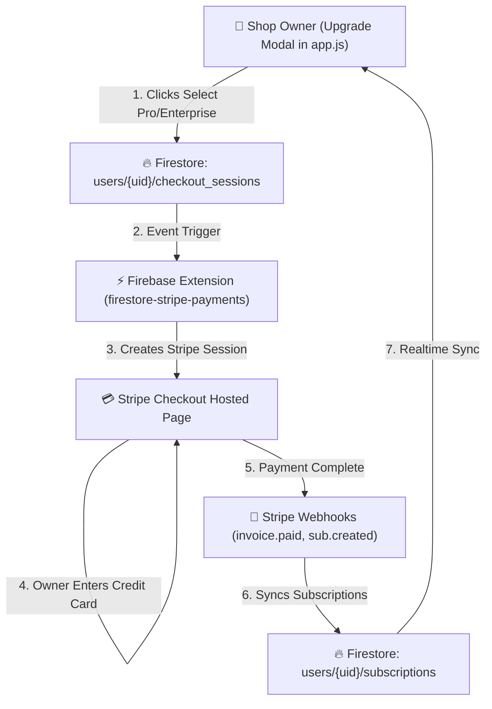

# WaitLink — Stripe Subscription Integration & Checkout Specification

## 1. Executive Summary & Integration Architecture

This document details the design and implementation plan for integrating **Stripe Checkout & Billing** into WaitLink for automated SaaS subscription management (**Starter Free**, **Pro Business $15/mo**, and **Enterprise $49/mo**).

The recommended enterprise standard for Firebase apps is the official **Firebase Extension: Run Payments with Stripe** (`stripe/firestore-stripe-payments`).

---

## 2. System Architecture & Subscription Data Flow



---

## 3. Required Credentials & Details Needed from You

To activate live Stripe payments, we need the following credentials from your **Stripe Dashboard** (or Test Keys for setup):

### A. Stripe API Keys (Found in Stripe Dashboard -> Developers -> API Keys)
1. **Publishable Key**: `pk_live_...` (or `pk_test_...` for development) — Used in client JS.
2. **Secret Key**: `sk_live_...` (or `sk_test_...`) — Configured safely in Firebase Secrets / Extension.

### B. Stripe Products & Price IDs (Created in Stripe Dashboard -> Products)
You will create 2 Recurring Subscription Products in Stripe:
1. **Pro Business Tier ($15 / month)**:
   * **Price ID**: `price_1Pxxxxxxxxxxxxxx` (Recurring Monthly)
2. **Enterprise Tier ($49 / month)**:
   * **Price ID**: `price_1Pyyyyyyyyyyyyyy` (Recurring Monthly)

### C. Stripe Webhook Signing Secret (Found under Webhooks in Stripe Console)
* **Webhook Endpoint Secret**: `whsec_...` — Enables Firebase to receive instant notifications when payments succeed, recur, or fail.

---

## 4. Firestore Schema & Subscription Syncing

### 4.1 Checkout Sessions Subcollection (`users/{uid}/checkout_sessions`)
When a user clicks "Upgrade to Pro", `app.js` creates a document in their `checkout_sessions` subcollection:

```json
{
  "price": "price_1Pxxxxxxxxxxxxxx",
  "success_url": "https://waitlink.app/?session_id={CHECKOUT_SESSION_ID}&payment=success",
  "cancel_url": "https://waitlink.app/?payment=cancelled",
  "mode": "subscription",
  "createdAt": 1728001234000
}
```

The extension creates a Stripe Checkout session and appends a `url` field to the document:
```json
{
  "url": "https://checkout.stripe.com/c/pay/cs_test_a1b2c3d4e5..."
}
```
`app.js` listens to this document and automatically redirects the shop owner to Stripe.

### 4.2 Subscriptions Subcollection (`users/{uid}/subscriptions`)
Once payment completes, Stripe automatically creates and syncs active subscription details:

```json
{
  "status": "active",
  "price": "price_1Pxxxxxxxxxxxxxx",
  "role": "pro",
  "current_period_end": 1730679600,
  "cancel_at_period_end": false,
  "created": 1728001234
}
```

---

## 5. Step-by-Step Installation & Client Code Integration

### Step 1: Install Firebase Stripe Extension
Run in terminal:
```bash
npx firebase-tools ext:install stripe/firestore-stripe-payments --project waitlink-app-8821
```

Set parameters during setup:
* **Stripe Restricted API Key**: `sk_test_...` / `sk_live_...`
* **Products and Prices Collection**: `products`
* **Customers Collection**: `users`

### Step 2: Include Stripe.js in `index.html`
Add Stripe.js script tag to `index.html`:
```html
<script src="https://js.stripe.com/v3/"></script>
```

### Step 3: Implement Stripe Upgrade Handler in `app.js`

Replace mock `selectUpgradeTier(tierKey)` in `app.js` with live Stripe Checkout creation:

```javascript
// Map Tier Keys to Stripe Price IDs
const STRIPE_PRICES = {
  pro: "price_1Pxxxxxxxxxxxxxx",       // Replace with actual Pro Price ID
  enterprise: "price_1Pyyyyyyyyyyyyyy" // Replace with actual Enterprise Price ID
};

async function selectUpgradeTier(tierKey) {
  if (tierKey === 'starter') {
    showToast("You are on the Starter (Free) Tier");
    closeUpgradeModal();
    return;
  }

  const priceId = STRIPE_PRICES[tierKey];
  if (!priceId) {
    showToast("Invalid subscription plan selected", "error");
    return;
  }

  if (!state.user || !state.user.uid) {
    showToast("Please sign in first to upgrade your subscription", "error");
    openAuthModal();
    return;
  }

  showToast("⏳ Opening secure Stripe Checkout...");

  try {
    // 1. Create Checkout Session Document in Firestore
    const docRef = await db.collection("users").doc(state.user.uid)
      .collection("checkout_sessions").add({
        price: priceId,
        success_url: window.location.origin + "/?payment=success",
        cancel_url: window.location.origin + "/?payment=cancelled",
        allow_promotion_codes: true,
        createdAt: Date.now()
      });

    // 2. Listen for URL generated by Firebase Stripe Extension
    docRef.onSnapshot((snap) => {
      const data = snap.data();
      if (data && data.url) {
        // Redirect user to Stripe Hosted Checkout
        window.location.href = data.url;
      } else if (data && data.error) {
        showToast("Stripe Error: " + data.error.message, "error");
      }
    });

  } catch (err) {
    console.error("Stripe Session Error:", err);
    showToast("Failed to initiate Stripe Checkout: " + err.message, "error");
  }
}
```

### Step 4: Add Realtime Subscription Listener in `app.js`

Automatically unlock Pro / Enterprise features when an active subscription exists:

```javascript
function listenToUserSubscription() {
  if (!state.user || !db) return;

  db.collection("users").doc(state.user.uid)
    .collection("subscriptions")
    .where("status", "in", ["active", "trialing"])
    .onSnapshot((snapshot) => {
      if (!snapshot.empty) {
        const sub = snapshot.docs[0].data();
        const role = sub.role || "pro";
        
        state.config.planTitle = role === "enterprise" ? "Enterprise Tier" : "Pro Business Tier";
        state.config.planPrice = role === "enterprise" ? 49 : 15;
        state.isSubscribed = true;
      } else {
        state.config.planTitle = "Starter Tier (Free)";
        state.config.planPrice = 0;
        state.isSubscribed = false;
      }
      saveConfig();
      renderAll();
    });
}
```

---

## 6. Self-Service Customer Billing Portal

Allow shop owners to manage or cancel their subscription anytime directly from WaitLink:

```javascript
async function openCustomerBillingPortal() {
  if (!state.user) return;
  showToast("Loading Billing Portal...");

  const functionRef = firebase.functions().httpsCallable('ext-firestore-stripe-payments-createPortalLink');
  try {
    const { data } = await functionRef({ returnUrl: window.location.origin });
    window.location.href = data.url;
  } catch (err) {
    console.error("Portal Error:", err);
    showToast("Unable to open billing portal", "error");
  }
}
```

---

## 7. Next Steps Checklist

1. [ ] **Provide Credentials**: Share test/live Stripe API Keys & Price IDs.
2. [ ] **Install Extension**: Run `npx firebase-tools ext:install stripe/firestore-stripe-payments`.
3. [ ] **Update `app.js`**: Connect `selectUpgradeTier(tierKey)` to trigger real Stripe Checkout sessions.
4. [ ] **Deploy & Test**: Test complete checkout flow with Stripe test card (`4242...`).
