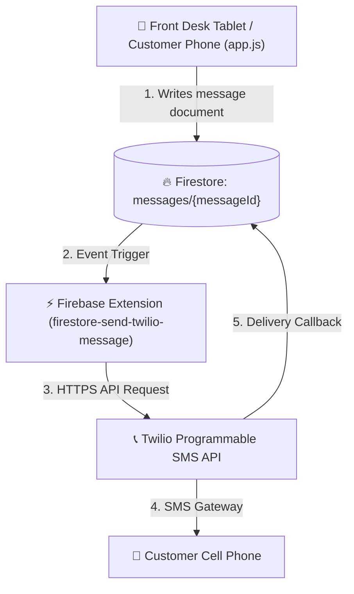
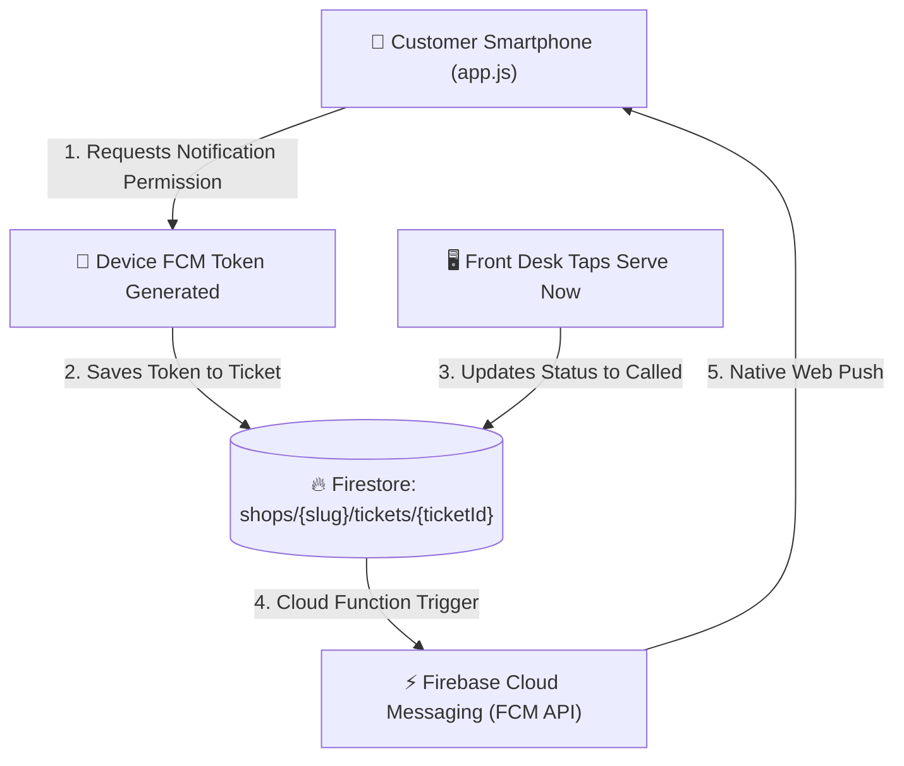

# WaitLink — Customer Notification Design Specification (Twilio SMS vs. Pure Firebase Web Push)

## 1. Executive Summary & Architectural Overview

WaitLink supports two primary pathways for sending real-time turn notifications to walk-in customers when staff tap **⏱️ SERVE NOW** / **SERVE NEXT**:

1. **Option A: Twilio SMS Integration (via Firebase Extension)** — Cellular text messages sent directly to customer mobile phone numbers. Requires an external telecommunications gateway (Twilio/Telnyx/AWS SNS).
2. **Option B: Pure Firebase Web Push Notifications (FCM)** — 100% FREE native notifications delivered to customer device screens via browser push tokens (no Twilio or cellular subscription required).

> [!IMPORTANT]
> **Can Firebase send SMS text messages natively without Twilio?**
> **No.** Firebase is a cloud backend platform, not a cellular telecommunications carrier. While Firebase handles database triggers and cloud compute, routing SMS text messages over cellular carrier networks (Verizon, AT&T, T-Mobile) requires a licensed carrier gateway (like Twilio, Telnyx, or AWS SNS).
> *Note: Firebase Authentication sends 6-digit OTP login codes via SMS natively, but Google strictly prohibits using Auth OTP for custom operational text messages.*

---

## 2. Solution Comparison Matrix

| Criteria | Option A: Twilio SMS Extension | Option B: Pure Firebase FCM Web Push | Option C: Alternative SMS Gateways (Telnyx / AWS SNS) |
| :--- | :--- | :--- | :--- |
| **Delivery Medium** | Cellular SMS Text Message | Mobile & Desktop Web Push Banners | Cellular SMS Text Message |
| **Monthly Cost** | ~$5.10 / month (500 texts + $1.15 number) | **$0.00 / month (100% FREE)** | ~$3.15 / month (500 texts @ $0.004/text) |
| **Hardware / App Req.** | Works on any mobile phone | Modern mobile browser (Chrome/Safari/Edge) | Works on any mobile phone |
| **Customer Opt-in** | Accepts SMS checkbox | Browser notification prompt ("Allow") | Accepts SMS checkbox |
| **Setup Complexity** | Low (Firebase Extension + Twilio Key) | Low (FCM Web SDK + `firebase-messaging-sw.js`) | Medium (Custom Cloud Function API call) |
| **Delivery Reliability** | High (Cellular signal) | High (Wi-Fi or Mobile Data) | High (Cellular signal) |

---

## 3. Option A Specification: Twilio SMS Integration

### 3.1 Architecture Diagram



### 3.2 Firestore Collection Schema (`messages`)

When an SMS event is triggered from `app.js`, a document is created in the `messages` collection:

```json
{
  "to": "+19802531359",
  "body": "Hi Senthil! Your service at Senthil Nail clinic is ready now. Please proceed to the front desk. View your ticket: https://waitlink.app?s=snailclinic&view=public&ticket=q_1728001234",
  "shopSlug": "snailclinic",
  "ticketId": "q_1728001234",
  "ticketUrl": "https://waitlink.app?s=snailclinic&view=public&ticket=q_1728001234",
  "triggerType": "CALLED_NOW",
  "createdAt": 1728001234000,
  "delivery": {
    "startTime": "2026-10-03T20:30:00.000Z",
    "state": "SUCCESS",
    "info": {
      "sid": "SMxxxxxxxxxxxxxxxxxxxxxxxxxxxxxxxx",
      "status": "delivered"
    }
  }
}
```

### 3.3 Step-by-Step Installation

1. Create a [Twilio Account](https://www.twilio.com) and buy a Twilio Phone Number.
2. Install the extension into the Firebase project:
   ```bash
   npx firebase-tools ext:install twilio/firestore-send-twilio-message --project waitlink-app-8821
   ```
3. Set Parameters:
   * **Account SID**: `TWILIO_ACCOUNT_SID`
   * **Auth Token**: `TWILIO_AUTH_TOKEN`
   * **Twilio Phone Number**: `+18039027464`
   * **Firestore Collection**: `messages`

### 3.4 Client Integration Code (`app.js`)

```javascript
// Send SMS via Firestore Trigger
function sendSmsNotification(customerPhone, messageBody, metadata = {}) {
  const e164Phone = formatPhoneE164(customerPhone);
  if (!e164Phone || !db) return;

  db.collection("messages").add({
    to: e164Phone,
    body: messageBody,
    shopSlug: state.config.slug,
    shopName: state.config.shopName,
    createdAt: Date.now(),
    ...metadata
  });
}
```

---

## 4. Option B Specification: Pure Firebase Web Push (FCM)

For zero monthly recurring costs, FCM Web Push Notifications allow WaitLink to pop up real-time lock-screen banners on the customer's smartphone without needing Twilio.

### 4.1 Architecture Diagram



### 4.2 Web Push Client Setup (`app.js` & `firebase-messaging-sw.js`)

#### 1. Register Service Worker (`firebase-messaging-sw.js`)
Create `firebase-messaging-sw.js` in root directory:

```javascript
importScripts('https://www.gstatic.com/firebasejs/10.8.0/firebase-app-compat.js');
importScripts('https://www.gstatic.com/firebasejs/10.8.0/firebase-messaging-compat.js');

firebase.initializeApp({
  apiKey: "YOUR_API_KEY",
  projectId: "waitlink-app-8821",
  messagingSenderId: "YOUR_SENDER_ID",
  appId: "YOUR_APP_ID"
});

const messaging = firebase.messaging();

messaging.onBackgroundMessage((payload) => {
  const notificationTitle = payload.notification.title;
  const notificationOptions = {
    body: payload.notification.body,
    icon: '/icon-192.png',
    vibrate: [200, 100, 200]
  };

  self.registration.showNotification(notificationTitle, notificationOptions);
});
```

#### 2. Request FCM Token on Customer Check-In (`app.js`)

```javascript
async function requestCustomerPushPermission(ticketId) {
  try {
    const messaging = firebase.messaging();
    const permission = await Notification.requestPermission();
    if (permission === 'granted') {
      const token = await messaging.getToken({ vapidKey: 'YOUR_PUBLIC_VAPID_KEY' });
      if (token && db) {
        await db.collection("shops").doc(state.config.slug)
          .collection("tickets").doc(ticketId)
          .update({ fcmToken: token });
      }
    }
  } catch (err) {
    console.warn("FCM registration deferred or not supported:", err);
  }
}
```

---

## 5. Cost Breakdown & Recommendation

| Component | Twilio SMS Route | Firebase FCM Web Push Route |
| :--- | :--- | :--- |
| **Monthly Gateway Fee** | $1.15 / month | **$0.00** |
| **Cost per 500 Notifications** | $3.95 / month | **$0.00** |
| **Total Monthly Cost** | **~$5.10 / month** | **$0.00 / month** |

### Recommendation
* **Start with Option B (Pure Firebase FCM Web Push)** for zero operating budget and immediate deployment.
* **Add Option A (Twilio SMS)** if your customer demographic prefers direct cellular text messages without enabling browser push notifications.

---

## 6. Compliance & Opt-Out Handling (TCPA & CTIA Guidelines)

1. **Explicit Opt-in**: Include opt-in checkbox during self check-in (`[x] Text me when my turn is ready`).
2. **Automated STOP/HELP**: Twilio automatically handles replies containing `STOP` or `UNSUBSCRIBE`.
3. **Disclosure Requirement**: Display text: *"Standard message and data rates may apply. Reply STOP to cancel."*

