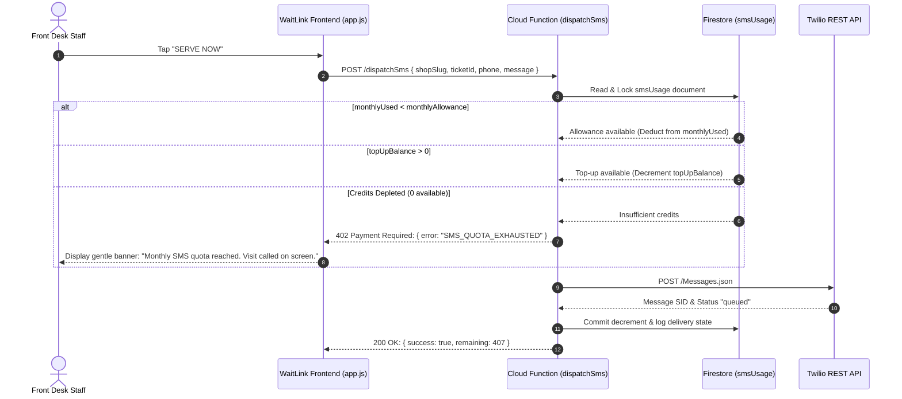

# WaitLink — SMS Volume Quota, Metering & Top-Up Architecture Design Specification
**Roadmap Phase**: P2 (UX & Scalability)  
**Status**: Future Roadmap Specification (Design Only — No Active Code)  
**Target Tier**: Pro Business Tier ($15/mo) & Enterprise Tiers

---

## 1. Executive Summary & Problem Statement

WaitLink's **Pro Business Tier** is priced at a flat rate of **$15/month**. One of its core flagship features is automated customer SMS notifications (live ticket tracking links upon check-in and instant turn alerts when staff tap **📞 SERVE NOW**).

### 1.1 The Mathematical Risk of Negative Gross Margins
Telecommunication carriers (Verizon, AT&T, T-Mobile, etc.) and telephony aggregators (Twilio) charge per outbound message segment. While software compute costs approach zero at scale, **telephony costs scale linearly with message volume**:

| Component | Cost per Outbound SMS (US/Canada) |
| :--- | :--- |
| Twilio Outbound Segment Fee | $0.0079 |
| Carrier A2P 10DLC Surcharges (Average across networks) | $0.0035 – $0.0050 |
| Shortener / Platform Gateway overhead | $0.0010 |
| **Total Realized Cost per Outbound Text Message** | **~$0.0125 to $0.0140 (~1.3¢)** |

#### Case Study: High-Volume Commercial Walk-In Tenant
Consider a bustling downtown barbershop, busy urgent-care clinic, or DMV office:
* **Walk-ins per day**: 75 customers
* **Days operational per month**: 26 days
* **Total customers per month**: 1,950
* **SMS messages per customer**: 2 (1 intake ticket link + 1 "Serve Now" call)
* **Total SMS dispatched**: **3,900 messages/month**
* **Twilio Cost incurred by WaitLink**: 3,900 × $0.013 = **$50.70/month**
* **Subscription Revenue collected from Tenant**: **$15.00/month**
* **WaitLink Net Profit on this Customer**: **-$35.70 / month (Negative 238% Margin)**

Without usage metering and volume boundaries, a single hyper-active tenant can wipe out the subscription profit of three average tenants. Furthermore, malicious bots or malicious actors repeatedly submitting public check-in forms could trigger unlimited billable outbound texts.

---

## 2. Solution Overview: Included Monthly Quota + On-Demand Top-Up Packs

Following industry-standard unit economics (e.g., Shopify, Square, Toast, Calendly), WaitLink will implement a **predictable bundled quota** paired with **self-serve, instant top-up packs**:

```mermaid
flowchart TD
    A["🏢 Shop Pro Plan ($15/mo)"] -->|Includes| B["📦 500 Monthly SMS Credits"]
    B -->|Normal Usage (0-500)| C["✅ Free Delivery (~$6.25 COGS, $8.75 Profit)"]
    B -->|Exhausted (> 500)| D{"Has Purchased Top-Up Credits?"}
    D -->|Yes| E["⚡ Deduct from Top-Up Pool"]
    D -->|No| F["🛑 Graceful SMS Pause & Top-Up Prompt"]
    F -->|1-Click Stripe Checkout| G["💳 Buy Top-Up Pack (+250 / +1,000 SMS)"]
    G -->|Instant Cloud Credit| E
```

### 2.1 Subscription Tier Allowances

| Tier | Monthly Price | Included SMS / Month | Estimated Twilio COGS | Gross Margin % |
| :--- | :--- | :--- | :--- | :--- |
| **Starter (Free)** | $0 / mo | **0 SMS** (Web Push & Screen only) | $0.00 | 100% |
| **Pro Business** | $15 / mo | **500 SMS** | ~$6.50 | **~57% Profit** |
| **Enterprise / Custom** | $49+ / mo | **2,500+ SMS** | ~$30.00 | **~39% Profit** |

*Note: 500 SMS covers ~250 walk-in customer visits per month (assuming 2 SMS per visit). For typical single-chair barbershops or specialty salons, 250 visits is ample. High-volume multi-chair shops comfortably graduate to top-up packs or Enterprise.*

### 2.2 Self-Serve Top-Up Packages (One-Time Add-Ons via Stripe)

When a business exhausts their monthly included 500 SMS credits, they can instantly purchase credit packs via Stripe Checkout:

| Package | One-Time Price | Added Credits | Effective Price / SMS | Realized Margin |
| :--- | :--- | :--- | :--- | :--- |
| **Micro Pack** | **$5.00** | +250 SMS | $0.020 / SMS | ~35% Margin |
| **Growth Pack** | **$15.00** | +1,000 SMS | $0.015 / SMS | ~15% Margin |
| **Power Pack** | **$30.00** | +2,500 SMS | $0.012 / SMS | Breakeven / Volume scale |

#### Credit Expiration Policy
* **Monthly Included Credits (500)**: Reset to 500 on the shop's monthly billing anniversary date (no rollover of unspent free subscription credits).
* **Purchased Top-Up Credits**: **Never expire**. They persist in the shop's reserve wallet and roll over month-to-month until fully consumed.

---

## 3. Data Model & Metering Architecture

### 3.1 Firestore Collection Schema (`shops/{slug}/billing/smsUsage`)

```json
{
  "monthlyAllowance": 500,
  "monthlyUsed": 342,
  "topUpBalance": 250,
  "totalAvailable": 408,
  "billingCycleStart": 1729000000000,
  "billingCycleEnd": 1731600000000,
  "lastResetAt": 1729000000000,
  "lifetimeSent": 1842,
  "abuseProtection": {
    "dailySentCount": 24,
    "lastSentDate": "2026-10-16",
    "dailyCap": 200
  }
}
```

### 3.2 Atomic Dispatch Transaction Logic

Whenever a Front Desk operator clicks **📞 SERVE NOW** or a customer signs up with SMS enabled:



---

## 4. Front Desk & Owner Settings User Experience

### 4.1 Shop Settings → "Notifications" Sub-Tab
In the newly restructured **Notifications** tab:
* **SMS Credit Gauge**:
  ```
  ┌────────────────────────────────────────────────────────┐
  │  📲 Monthly SMS Usage: 342 / 500 Used (68%)           │
  │  [████████████████░░░░░░░░]  158 Remaining             │
  │  Resets on Nov 1st • Reserve Top-Up: +250 SMS          │
  │                                                        │
  │  [ ⚡ Buy SMS Top-Up Pack ]   [ View SMS History Log ]  │
  └────────────────────────────────────────────────────────┘
  ```
* **Low Balance Warning Thresholds**:
  * **At 80% (400 / 500 used)**: An informational amber banner warns the owner: *"You have used 80% of your included SMS alerts for this month."*
  * **At 100% (500 / 500 used)**: Notice informs the owner: *"Monthly SMS limit reached. Buy an add-on pack or alerts will resume on your next billing date."*

### 4.2 Front Desk Staff Continuity (Zero Disruption Principle)
A critical rule of walk-in operations: **Queue management must NEVER crash or freeze because SMS ran out.**
* If a shop runs out of SMS credits:
  * Front Desk staff can still tap **📞 SERVE NOW**.
  * The customer's ticket advances to **"Visit In Progress"** on screen.
  * Audio chime sounds and 3D lobby stage highlights the customer name.
  * Only the background cellular SMS dispatch is skipped.
  * A small toast informs staff: *"Customer called to desk. (SMS alert paused — monthly limit reached)."*

---

## 5. Anti-Abuse, TCPA & Fraud Protection

### 5.1 Rate Limiting per Destination Number
To prevent bad actors from checking in repeatedly to spam a victim's phone number or rack up shop bills:
* **Per-Phone Daily Cap**: A maximum of **3 SMS per phone number per day per shop**.
* Attempting a 4th check-in displays: *"SMS alerts currently active for this number today. Please listen for your name in the lobby."*

### 5.2 Destination Country Gating
* **Domestic Only by Default**: Standard packages allow domestic numbers (+1 US & Canada).
* **International Routing**: Overseas carrier rates can exceed $0.08/text. International numbers require Enterprise tier or debit **4 credits per international SMS**.

---

## 6. Implementation Milestones

### Phase 1: Passive Metering & Visibility (Zero Cost Phase)
* Add `smsUsage` counter in Firestore tracking every sent message.
* Display the live counter in the **Notifications** sub-tab so owners can see their real-world monthly consumption without any enforcement.

### Phase 2: Stripe Top-Up Checkout Integration
* Add Stripe Checkout one-time payment sessions for the +250 ($5) and +1,000 ($15) credit packs.
* Implement Stripe webhook to credit `topUpBalance` upon payment confirmation.

### Phase 3: Quota Gating & Automated Owner Alerts
* Implement the atomic credit validation in Cloud Function dispatch.
* Send automated email notification to the shop owner at 80% and 100% threshold crossings.

---

## 7. Conclusion

By implementing a **500 SMS monthly quota** on the $15/mo Pro tier with **self-serve $5/$15 top-up packs**:
1. **WaitLink guarantees profitability on 100% of Pro subscribers**, eliminating the negative margin trap.
2. **Normal shops never notice a restriction** (500 texts easily covers standard month-to-month walk-in volume).
3. **High-volume shops happily pay for add-on packs**, transforming a potential cost drain into an incremental expansion revenue stream.
