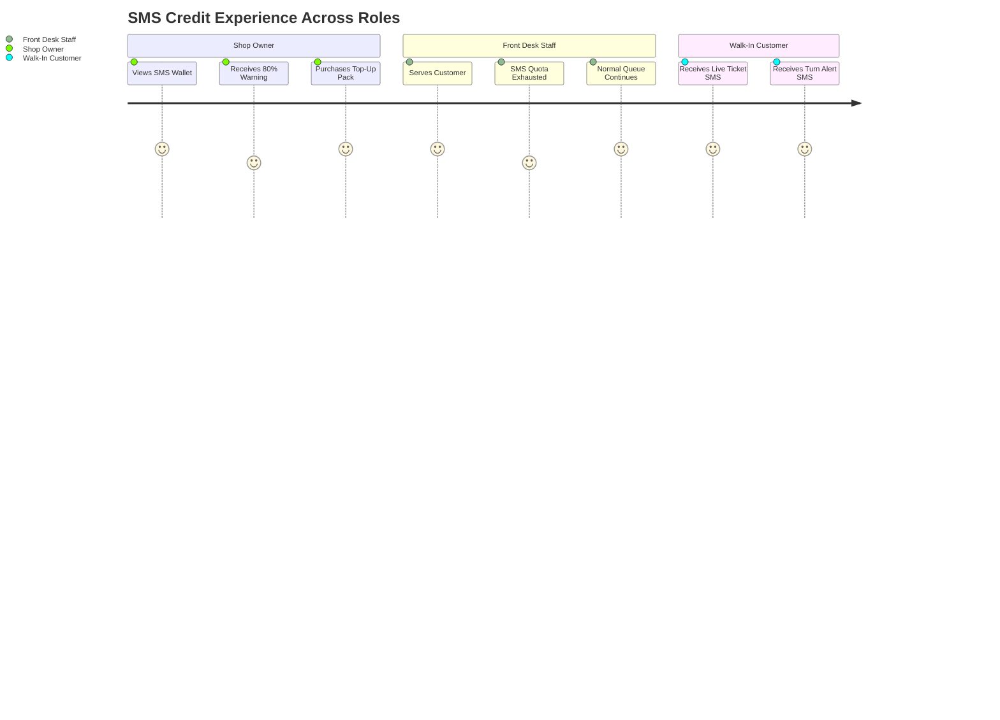

# WaitLink — SMS Volume Quota, Metering & Top-Up Architecture Design Specification
**Roadmap Phase**: P2 (UX & Scalability)  
**Status**: Comprehensive Technical & UX Design Specification  
**Target Tiers**: Pro Business Tier ($15/mo), Enterprise Tiers ($49+/mo), and Add-On Top-Up Packs  

---

## 1. Executive Summary & Problem Statement

WaitLink's **Pro Business Tier** is priced at a flat rate of **$15/month**. One of its core flagship features is automated customer SMS notifications:
1. **Intake Confirmation**: Live web ticket link delivered upon customer check-in.
2. **Turn Alerts**: Instant SMS alert when staff tap **📞 SERVE NOW**.

### 1.1 The Mathematical Risk of Negative Gross Margins
Telecommunication carriers (Verizon, AT&T, T-Mobile, etc.) and telephony aggregators (Twilio) charge per outbound message segment. While software compute costs approach zero at scale, **telephony costs scale linearly with message volume**:

| Component | Cost per Outbound SMS (US/Canada) |
| :--- | :--- |
| Twilio Outbound Segment Fee | $0.0079 |
| Carrier A2P 10DLC Surcharges (Average across networks) | $0.0035 – $0.0050 |
| Shortener / Platform Gateway overhead | $0.0010 |
| **Total Realized Cost per Outbound Text Message** | **~$0.0125 to $0.0140 (~1.3¢)** |

#### Case Study: High-Volume Commercial Walk-In Tenant
Consider a bustling downtown barbershop, busy urgent-care clinic, or DMV office:
* **Walk-ins per day**: 75 customers
* **Days operational per month**: 26 days
* **Total customers per month**: 1,950
* **SMS messages per customer**: 2 (1 intake ticket link + 1 "Serve Now" call)
* **Total SMS dispatched**: **3,900 messages/month**
* **Twilio Cost incurred by WaitLink**: 3,900 × $0.013 = **$50.70/month**
* **Subscription Revenue collected from Tenant**: **$15.00/month**
* **WaitLink Net Profit on this Customer**: **-$35.70 / month (Negative 238% Margin)**

Without usage metering and volume boundaries, a single hyper-active tenant can wipe out the subscription profit of three average tenants. Furthermore, malicious bots or actors repeatedly submitting public check-in forms could trigger unlimited billable outbound texts.

---

## 2. Solution Overview: Included Monthly Quota + On-Demand Top-Up Packs

Following industry-standard unit economics (e.g., Shopify, Square, Toast, Calendly), WaitLink implements a **predictable bundled quota** paired with **self-serve, instant top-up packs**:

```mermaid
flowchart TD
    A["🏢 Shop Pro Plan ($15/mo)"] -->|Includes| B["📦 500 Monthly SMS Credits"]
    B -->|Normal Usage (0-500)| C["✅ Free Delivery (~$6.50 COGS, $8.50 Profit)"]
    B -->|Exhausted (> 500)| D{"Has Purchased Top-Up Credits?"}
    D -->|Yes| E["⚡ Deduct from Top-Up Reserve Wallet"]
    D -->|No| F["🛑 Graceful SMS Pause & Top-Up Prompt"]
    F -->|1-Click Stripe Checkout| G["💳 Buy Top-Up Pack (+250 / +1,000 / +2,500 SMS)"]
    G -->|Instant Cloud Credit| E
```

### 2.1 Subscription Tier Allowances

| Tier | Monthly Price | Included SMS / Month | Estimated Twilio COGS | Gross Margin % |
| :--- | :--- | :--- | :--- | :--- |
| **Starter (Free)** | $0 / mo | **0 SMS** (Web Push & Screen only) | $0.00 | 100% |
| **Pro Business** | $15 / mo | **500 SMS** | ~$6.50 | **~57% Profit** |
| **Enterprise / Custom** | $49+ / mo | **2,500+ SMS** | ~$30.00 | **~39% Profit** |

*Note: 500 SMS covers ~250 walk-in customer visits per month (assuming 2 SMS per visit). For typical single-chair barbershops or specialty salons, 250 visits is ample. High-volume multi-chair shops comfortably graduate to top-up packs or Enterprise.*

### 2.2 Self-Serve Top-Up Packages (One-Time Add-Ons via Stripe)

When a business exhausts their monthly included 500 SMS credits, they can instantly purchase credit packs via Stripe Checkout:

| Package | One-Time Price | Added Credits | Effective Price / SMS | Realized Margin | Stripe Product Name |
| :--- | :--- | :--- | :--- | :--- | :--- |
| **Micro Pack** | **$5.00** | +250 SMS | $0.020 / SMS | ~26% Margin (+$1.30) | `WaitLink SMS Top-Up — Micro (+250 SMS)` |
| **Growth Pack** | **$15.00** | +1,000 SMS | $0.015 / SMS | ~8.4% Margin (+$1.26) | `WaitLink SMS Top-Up — Growth (+1,000 SMS)` |
| **Power Pack** | **$39.00** | +2,500 SMS | $0.0156 / SMS | ~13.0% Margin (+$5.07) | `WaitLink SMS Top-Up — Power (+2,500 SMS)` |

#### Credit Expiration & Rollover Policy (Option A vs. Option B Engine)

WaitLink supports two rollover models for included subscription credits, switchable in real-time by the SuperAdmin via the **💎 Pricing Config & Tiers** console:

* **Option A: Strict Monthly Refresh (Default Plan Quota)**:
  * Unused monthly included credits (out of 500) expire at the end of the 30-day billing cycle.
  * Every billing cycle starts fresh with exactly 500 SMS.
  * *Rationale*: Maximizes operator margin stability and mirrors telecom enterprise contracts.
* **Option B: 1-Month Rollover Bank (Capped at 2× Quota = 1,000 SMS) — RECOMMENDED & ACTIVE**:
  * Unused included credits roll over into the next month's allowance, capped at **1,000 SMS max** (500 current month + up to 500 rolled over from prior month).
  * Rollover credits last for 1 additional billing cycle.
  * *Rationale*: Outstanding customer goodwill, eliminates "use-it-or-lose-it" anxiety, and makes Pro ($15/mo) feel like an incredible deal for seasonal or variable-traffic shops.
* **Purchased Top-Up Packs (+250, +1,000, +2,500)**:
  * **NEVER EXPIRE under BOTH Option A and Option B**.
  * Top-up credits are stored in an independent reserve wallet (`topUpBalance`) and roll over indefinitely month-to-month until 100% consumed.
* **SuperAdmin Dynamic Policy Toggle**:
  * Located in SuperAdmin under **💎 Pricing Config & Tiers**.
  * Allows platform administrators to switch between Option A and Option B platform-wide or per-tenant with a single click, without restarting services or modifying code.

---

## 3. Stripe Configuration Guide (Steps to Do in Stripe Dashboard)

To support self-serve SMS Top-Up purchases, you need to configure **3 One-Time Products** in your Stripe Dashboard. 

> [!NOTE]
> Unlike your existing monthly subscriptions ($15 Pro & $49 Enterprise), Top-Up packs are **One-Time Payments** (`mode: "payment"`). They do **NOT** recur automatically.

### 3.1 Step-by-Step Instructions in Stripe Dashboard:

1. Log into your [Stripe Dashboard](https://dashboard.stripe.com).
2. In the left navigation, click **Product catalog** (or **Products**).
3. Click the purple **+ Add product** button (top right).
4. Create the **3 Products** using the exact settings below:

#### Product 1: Micro Pack (+250 SMS)
* **Name**: `WaitLink SMS Top-Up — Micro (+250 SMS)`
* **Description**: `250 Outbound SMS Customer Alerts. Credits never expire and roll over indefinitely.`
* **Pricing model**: Standard pricing
* **Price**: `$5.00` USD
* **Billing frequency**: **One-time** (Do *NOT* select "Recurring")
* Click **Save product**.
* Copy the generated **Price ID** (starts with `price_...`).

#### Product 2: Growth Pack (+1,000 SMS) — Most Popular
* **Name**: `WaitLink SMS Top-Up — Growth (+1,000 SMS)`
* **Description**: `1,000 Outbound SMS Customer Alerts. Recommended for busy walk-in shops. Credits never expire.`
* **Pricing model**: Standard pricing
* **Price**: `$15.00` USD
* **Billing frequency**: **One-time**
* Click **Save product**.
* Copy the generated **Price ID** (starts with `price_...`).

#### Product 3: Power Pack (+2,500 SMS) — Best Value
* **Name**: `WaitLink SMS Top-Up — Power (+2,500 SMS)`
* **Description**: `2,500 Outbound SMS Customer Alerts for high-volume venues. Credits never expire.`
* **Pricing model**: Standard pricing
* **Price**: `$39.00` USD
* **Billing frequency**: **One-time**
* Click **Save product**.
* Copy the generated **Price ID** (starts with `price_...`).

### 3.2 Where These Price IDs Go in WaitLink:
Save the 3 copied Price IDs in your project secrets ([stripe_credentials.json](file:///c:/Workspaces/WaitLink/stripe_credentials.json) and Cloud Functions config):
```json
{
  "topup_micro_price_id": "price_1xxxxxx",
  "topup_growth_price_id": "price_1yyyyyy",
  "topup_power_price_id": "price_1zzzzzz"
}
```

---

## 4. Comprehensive Edge Cases & Technical Behavioral Protocols

To ensure 100% robustness and prevent billing or operational surprises, the system adheres to the following 8 edge-case rules:

### Edge Case 1: Carrier Multi-Segment Penalty & Emojis ("The Emoji Trap")
* **Telecom Reality**: Standard GSM-7 encoding allows **160 characters** per segment. If a shop owner writes an emoji (`💈`, `✂️`, `🕒`), carriers enforce **UCS-2 encoding**, dropping the limit to **70 characters** per segment. A 140-char message with an emoji is billed by Twilio as 2 segments!
* **UX Solution**: In the Template Customizer (Owner Settings &rarr; Notifications), provide a **Live Character & Segment Meter**:
  ```text
  Template: "Hi {name}! Your turn at {shop} is ready ✂️. Link: {link}"
  [ 74/70 Characters • 2 Carrier Segments ⚠️ (Emoji UCS-2 Encoding) ]
  💡 Tip: Remove emojis to fit in a single 160-character segment and save credits.
  ```
* **Debit Rule**: Outbound credits are debited based on actual carrier segments:
  $$\text{Credits Debited} = \max(1, \lceil \text{Calculated Segments} \rceil)$$

### Edge Case 2: Carrier Delivery Failures & Invalid Numbers (No-Debit Guarantee)
* If a customer provides a landline, disconnected number, or invalid syntax:
* Twilio immediately rejects with error codes (e.g., `21211` Invalid Number, `21614` Landline/Not SMS capable).
* **Protocol**: **Credit Safe Guard**. The transaction only decrements the shop's credit wallet if Twilio returns an HTTP `201/200` with an active `message.sid`. If Twilio rejects the dispatch prior to carrier handoff, **0 credits are deducted**.

### Edge Case 3: Customer Opt-Outs (`STOP` / `UNSUBSCRIBE`)
* If a customer replies `STOP` to the Twilio number, Twilio blocks future texts to that phone (Error `21610`).
* **Protocol**: If Twilio returns `21610`, the Cloud Function skips debiting credits and logs an activity in the customer's audit trail:
  `"📲 SMS skipped: Customer previously texted STOP to unsubscribe. Staff notified to call verbally."`
* Front desk staff see an amber badge next to the phone number: `[🔕 Opted Out]`.

### Edge Case 4: Multi-Location Accounts (Pooled Wallet vs. Isolated Stores)
* Business owners often operate multiple locations (e.g., 3 barbershop branches).
* **Protocol**: **Pooled Owner Reserve with Per-Location Usage Sub-Meters**.
  * Each store has its own 500 included monthly credits.
  * Purchased top-up credits are pooled in the Owner's central reserve wallet. If Store A has a monster Saturday and burns past 500, it automatically draws from the Owner's shared top-up pool without requiring a separate purchase per store.
  * The Owner Dashboard shows a clear breakdown: *Store A (420 SMS), Store B (210 SMS), Store C (140 SMS)*.

### Edge Case 5: Subscription Lifecycle Changes (Upgrades, Downgrades & Delinquency)
* **Mid-Cycle Upgrade (Pro $15 &rarr; Enterprise $49)**:
  * Stripe prorates the subscription fee.
  * WaitLink immediately credits the difference in monthly allowance ($2,500 - 500 = +2,000 SMS).
* **Downgrade to Starter ($0)**:
  * Unused free subscription allowance forfeits at cycle end.
  * **Purchased top-up credits are NEVER forfeited**. They remain safely vaulted in Firestore. If the owner re-upgrades 6 months later, their top-up balance is fully intact.
* **Payment Delinquency (Card Failed at Renewal)**:
  * Stripe attempts Smart Retries for 3–5 days.
  * **Grace Period**: The shop continues to send alerts from their remaining balance for 48 hours. If payment remains uncollected after 48 hours, SMS is politely muted while on-screen queue calling remains 100% active.

### Edge Case 6: Double-Tap & Rapid Re-Check-In Spam (Idempotency Window)
* Walk-in customers with weak cellular connections frequently tap "Join Waitlist" 3 or 4 times in quick succession.
* **Protocol**: **60-Second Idempotency Lock**.
  * The Cloud Function computes an idempotency hash: `hash(shopSlug + phone + triggerType + ticketId)`.
  * If a duplicate dispatch arrives within 60 seconds, it returns the existing message SID without firing a new text or deducting additional credits.

### Edge Case 7: Timezones & Billing Boundaries
* Shops operate across different timezones (EST, CST, PST, GMT, etc.).
* **Protocol**: The credit renewal timestamp (`billingCycleEnd`) is **strictly mapped to Stripe's exact UTC epoch** (`subscription.current_period_end`).
* The reset occurs automatically when the Stripe invoice succeeds or when `Date.now() >= billingCycleEnd`.

### Edge Case 8: SuperAdmin Governance & Support Credit Overrides
* **Customer Support Goodwill**: If a merchant experiences telephony issues or carrier delays, the SuperAdmin can grant courtesy credits directly from the SuperAdmin dashboard:
  * `[ + Add Courtesy Credits ]` (e.g., +100 SMS) with mandatory audit reason (e.g., *"Courtesy compensation for carrier outage"*).
* **Platform Gross Margin Monitor**: SuperAdmin view includes an aggregate financial health widget:
  * *Total Outbound SMS This Month (Platform-wide)*
  * *Total Twilio Carrier Spend ($)* vs. *Total Top-Up Revenue Collected ($)*
  * *Net Telephony Margin %*

---

## 5. User Experience & UI Wireframes Across All Roles



### 5.1 Shop Owner UX (Settings & Dashboard)

#### Screen 1: The SMS Credit Wallet Card (in Settings &rarr; Notifications)
```text
┌────────────────────────────────────────────────────────────────────────────────────────┐
│ 📲 SMS Notification Quota & Credit Wallet                                              │
├────────────────────────────────────────────────────────────────────────────────────────┤
│                                                                                        │
│   Monthly Included Usage: 342 / 500 Used (68%)                                         │
│   [████████████████████████████████░░░░░░░░░░░░░░░░]  158 Remaining                    │
│                                                                                        │
│   ┌──────────────────────────┐  ┌──────────────────────────┐  ┌─────────────────────┐  │
│   │ Included Plan Allowance  │  │ Top-Up Reserve Wallet    │  │ Total Available SMS │  │
│   │ 500 SMS / month          │  │ +250 SMS (Never Expires) │  │ 408 SMS Available   │  │
│   └──────────────────────────┘  └──────────────────────────┘  └─────────────────────┘  │
│                                                                                        │
│   ℹ️ Included plan credits reset to 500 on Nov 1st. Top-up packs never expire.          │
│                                                                                        │
│   [ ⚡ Buy SMS Top-Up Pack ]                [ 📋 View Outbound Dispatch Log ]           │
└────────────────────────────────────────────────────────────────────────────────────────┘
```

#### Screen 2: Top-Up Pack Selection Modal
```text
┌───────────────────────────────────────────────────────────────────────────────────────┐
│  ⚡ Purchase Additional SMS Credits                                                ✕  │
│  Top-up credits never expire and roll over month-to-month until used.                 │
├───────────────────────────────────────────────────────────────────────────────────────┤
│                                                                                       │
│  ┌───────────────────────┐  ┌────────────────────────┐  ┌──────────────────────────┐  │
│  │      MICRO PACK       │  │      GROWTH PACK       │  │        POWER PACK        │  │
│  │                       │  │   ⭐ MOST POPULAR ⭐    │  │                          │  │
│  │        +250           │  │        +1,000          │  │          +2,500          │  │
│  │     SMS Credits       │  │      SMS Credits       │  │       SMS Credits        │  │
│  │                       │  │                        │  │                          │  │
│  │     $5.00 one-time    │  │     $15.00 one-time    │  │      $39.00 one-time     │  │
│  │    (2.0¢ / message)   │  │    (1.5¢ / message)    │  │     (1.56¢ / message)    │  │
│  │                       │  │                        │  │                          │  │
│  │   [ Select $5 Pack ]  │  │  [ Select $15 Pack ]   │  │   [ Select $39 Pack ]    │  │
│  └───────────────────────┘  └────────────────────────┘  └──────────────────────────┘  │
│                                                                                       │
│  🔒 Secure 1-Click Checkout powered by Stripe • Credits instantly added to wallet     │
└───────────────────────────────────────────────────────────────────────────────────────┘
```

### 5.2 Front Desk Staff UX (Zero Disruption Principle)
* **Staff Priority**: Front desk operations must **never be interrupted**.
* When credits reach 0:
  1. Staff click **📞 SERVE NOW**.
  2. The customer's card advances to **"Visit In Progress"**.
  3. Audio bell rings in lobby.
  4. Lobby stage displays customer name.
  5. The carrier cellular text is skipped.
  6. Toast notification informs staff: `"Called to desk. (SMS alert skipped — monthly quota reached)."`.
  7. A discreet top banner informs the manager: `"⚠️ SMS alerts paused (0 credits remaining). [Owner Top-Up]"`.

### 5.3 Walk-In Customer UX
* Customer receives crisp, personalized text messages with zero delay:
  * Check-In: `"Hi Alex! You're #3 in line at Main St Barbers. Est wait: ~18m. Track live ticket: https://waitlink.app/?s=main-st-barbers&ticket=q_101"`
  * Call Turn: `"Hi Alex! Your turn at Main St Barbers is ready now! Please proceed to the front desk."`
* If shop credits are exhausted, the customer's on-screen QR card displays: `"Please watch the lobby display for your name."`

### 5.4 SuperAdmin UX & Policy Governance (Inside "💎 Pricing Config & Tiers")

To avoid navigation tab bloat (SuperAdmin currently features 4 focused tabs: *Master Shops*, *Pricing Config*, *Support Inbox*, and *Data Retention*), the **SMS Quota & Rollover Policy Controller** is integrated directly into **`💎 Pricing Config & Tiers`** (`superpanel-pricing`). 

This keeps all billing economics, plan limits, and rollover governance consolidated in one unified control room.

#### SuperAdmin Rollover Policy Controller (Wireframe)
```text
┌────────────────────────────────────────────────────────────────────────────────────────┐
│ ⚙️ SuperAdmin Policy: SMS Subscription Quota & Rollover Governance                    │
├────────────────────────────────────────────────────────────────────────────────────────┤
│ Select how unused monthly subscription credits (500 SMS/mo on Pro) are handled at renewal: │
│                                                                                        │
│   ┌─────────────────────────────────────┐   ┌──────────────────────────────────────┐   │
│   │  🔄 OPTION A: STRICT MONTHLY RESET  │   │  🎁 OPTION B: 1-MONTH ROLLOVER BANK  │   │
│   │                                     │   │                                      │   │
│   │  • Unused monthly quota expires     │   │  • Unused credits roll over 1 month  │   │
│   │  • Refreshes to exact 500 each cycle│   │  • Capped at 1,000 SMS max bank      │   │
│   │  • Strict margin predictability     │   │  • Outstanding merchant satisfaction │   │
│   │                                     │   │  ⭐ Currently Active (Recommended)   │   │
│   │        [ Activate Option A ]        │   │        [ ✓ Option B Active ]         │   │
│   └─────────────────────────────────────┘   └──────────────────────────────────────┘   │
│                                                                                        │
│   ⚡ Top-Up Packs (+250 / +1,000 / +2,500): Always permanent & never expire under both.│
│   💾 Changes take effect immediately for all subsequent billing renewal cycles.        │
│   [ 💾 Save & Publish Global Telephony Policy ]                                        │
└────────────────────────────────────────────────────────────────────────────────────────┘
```

#### Renewal Calculation Engine (Stripe Webhook: `invoice.payment_succeeded`)
When the monthly renewal invoice clears, the Cloud Function inspects `systemConfig/telephony.rolloverPolicy`:

* **If `rolloverPolicy === "option_a"`**:
  $$\text{newMonthlyAllowance} = 500$$
  $$\text{monthlyUsed} = 0$$
  *(Unused subscription credits are cleared; `topUpBalance` is untouched).*

* **If `rolloverPolicy === "option_b"`**:
  $$\text{unspentPrior} = \max(0, \text{currentMonthlyAllowance} - \text{monthlyUsed})$$
  $$\text{rolledOver} = \min(500, \text{unspentPrior})$$
  $$\text{newMonthlyAllowance} = 500 + \text{rolledOver} \quad (\text{Max 1,000 SMS})$$
  $$\text{monthlyUsed} = 0$$
  *(Merchant enters the new month with up to 1,000 allowance before top-ups are ever touched).*

---

### 5.5 Public Pricing Page Messaging (`pricing.html`) for All Tiers

To ensure complete transparency and eliminate customer confusion or billing disputes, the public pricing page presents the following exact limits:

| Plan Tier | Display Price | SMS Customer Alert Quota | Additional Channel Features | Top-Up Eligibility |
| :--- | :--- | :--- | :--- | :--- |
| **Starter** | **$0 / mo** (Free Forever) | **0 SMS** *(No cellular SMS)* | • Live Mobile Web Card QR<br>• In-Lobby Big Screen Calling<br>• Audible Turn Chimes | Ineligible *(Must upgrade to Pro to unlock SMS)* |
| **Pro Business** | **$15 / mo** | **500 SMS / month** Included<br>*(+ 1-Month Rollover Bank up to 1,000 SMS)* | • Automated Twilio "Turn Ready" SMS<br>• Live Ticket Tracking Link<br>• Custom SMS Brand Sender | **Eligible** for One-Time Top-Up Packs ($5 / $15 / $39) that never expire |
| **Enterprise** | **$49+ / mo** | **2,500+ SMS / month** Included | • Dedicated Telephony Routing<br>• Multi-Location Pooled Credits<br>• Priority Throughput | **Eligible** with Wholesale Volume Rates |

#### Public Pricing Page Tier Card Copy:
* **Starter Card ($0)**:
  * `✕ No Automated SMS Notifications (In-Lobby & Live Web Card only)`
* **Pro Business Card ($15)**:
  * `✓ 📱 500 Automated SMS Customer Alerts / mo included`
  * `✓ 🎁 Rollover Protection: Unused monthly texts roll over (up to 1,000 SMS bank)`
  * `✓ ⚡ Instant On-Demand Top-Up Packs from $5 (Credits never expire)`
* **Enterprise Card ($49)**:
  * `✓ 📱 2,500+ Automated SMS Customer Alerts / mo included`
  * `✓ 🏢 Multi-Location Centralized SMS Wallet Pool`

---

### 5.6 Automated Transactional Confirmation Emails (Brevo / Resend Engine)

To deliver an elite merchant onboarding and payment experience, WaitLink dispatches automated, luxury-branded HTML confirmation emails immediately upon payment completion via the server-side `dispatchEmail` engine (Primary: Brevo REST API, Fallback: Resend).

```mermaid
flowchart TD
    A["💳 Stripe Payment Completed"] -->|Session Verified| B{"Purchase Type"}
    B -->|Monthly Subscription ($15 Pro / $49 Enterprise)| C["📧 Email 1: Subscription Upgrade Confirmation"]
    B -->|One-Time SMS Top-Up Pack ($5 / $15 / $39)| D["📧 Email 2: SMS Top-Up Credit Confirmation"]
    C -->|Brevo / Resend| E["📬 Merchant Inbox (Owner Email)"]
    D -->|Brevo / Resend| E
```

#### Email Template 1: Subscription Upgrade Confirmation (Pro & Enterprise)
* **Trigger**: Fired by `verifyStripeSessionAndUpgrade` immediately upon cryptographic validation of the Stripe Checkout session.
* **Recipient**: Registered shop owner email (`shopData.ownerEmail`).
* **Subject**: `🎉 Your WaitLink Pro Upgrade is Confirmed! (500 SMS Credits Activated)`
* **Key Content Components**:
  1. **Branded Header**: WaitLink logo + celebratory badge (`🎉 You're Officially on Pro!`).
  2. **Plan & Billing Summary**:
     * Plan Name: **Pro Business Plan** ($15.00 / month)
     * Billing Cycle: Automatically renews monthly; cancel anytime with 1-click.
     * Quota Activated: **500 Outbound SMS Customer Alerts / month**.
     * Rollover Policy: Active protection (Unspent credits roll over up to 1,000 SMS bank).
  3. **Direct Merchant Launchpad**:
     * Button: `[ 🔑 Open Owner Admin Portal ]`
     * Button: `[ 💈 Open Front Desk Controller ]`
  4. **Self-Serve Invoicing & Billing Portal**:
     * Direct link to the Stripe Customer Billing Portal where merchants can download official PDF tax invoices, update credit cards, or view billing history.

#### Email Template 2: SMS Top-Up Credit Confirmation
* **Trigger**: Fired by `verifyStripeTopUpSession` (or Stripe Webhook) immediately upon successful one-time top-up checkout.
* **Recipient**: Registered shop owner email.
* **Subject**: `⚡ +[Credits] SMS Credits Added to Your WaitLink Reserve Wallet` *(e.g., `⚡ +1,000 SMS Credits Added to Your WaitLink Reserve Wallet`)*
* **Key Content Components**:
  1. **Wallet Receipt Breakdown Table**:
     * Package Purchased: **Growth Pack (+1,000 SMS)** *(or Micro / Power)*
     * Amount Paid: **$15.00 USD (One-Time)**
     * Credits Added: **+1,000 Outbound SMS**
     * New Total Available Balance: **1,420 SMS Available**
  2. **Permanent Guarantee Callout**:
     * `🔒 Lifetime Guarantee: Your purchased top-up credits NEVER expire. They stay safely in your reserve wallet and roll over month-to-month until 100% consumed.`
  3. **Operational Visibility**:
     * Button: `[ 📲 View SMS Credit Wallet & Usage Logs ]`
     * Summary of recent dispatch volume and real-time balance tracker link.

---

## 6. Firestore Collection Schema

### 6.1 Global SuperAdmin Telephony Configuration (`systemConfig/telephony`)
This platform document stores the global policy switch toggled by the SuperAdmin:

```json
{
  "rolloverPolicy": "option_b",
  "optionBMaxBank": 1000,
  "defaultProQuota": 500,
  "updatedAt": 1729100000000,
  "updatedBy": "superadmin@waitlink.app"
}
```

### 6.2 Per-Shop SMS Wallet & Metering (`shops/{slug}/billing/smsUsage`)

```json
{
  "monthlyAllowance": 500,
  "rolledOverFromPriorMonth": 158,
  "monthlyUsed": 342,
  "topUpBalance": 250,
  "totalAvailable": 566,
  "billingCycleStart": 1729000000000,
  "billingCycleEnd": 1731600000000,
  "lastResetAt": 1729000000000,
  "lifetimeSent": 1842,
  "lastAlertThreshold": 80,
  "abuseProtection": {
    "dailySentCount": 24,
    "lastSentDate": "2026-10-16",
    "dailyCap": 200
  },
  "recentDispatches": [
    {
      "ticketId": "q_1729100234_abc",
      "phone": "+1980***1359",
      "segments": 1,
      "dispatchedAt": 1729100235000,
      "twilioSid": "SM1234567890abcdef",
      "status": "delivered"
    }
  ]
}
```

---

## 7. Phased Implementation Roadmap

* **Phase 1 (Visibility & Telemetry)**:
  * Create `smsUsage` document in Firestore.
  * Meter outbound dispatches passively (increment `monthlyUsed` without enforcing blocks).
  * Render the SMS Credit Gauge in Settings &rarr; Notifications.
* **Phase 2 (Stripe Top-Up Checkout & Confirmation Emails)**:
  * Configure the 3 Top-Up Products in Stripe ($5 Micro, $15 Growth, $39 Power).
  * Build `createStripeTopUpSession` Cloud Function (`mode: "payment"`).
  * Implement `verifyStripeTopUpSession` and Stripe Webhook to credit `topUpBalance` upon payment.
  * **Integrate Subscription Upgrade Confirmation Email** into `verifyStripeSessionAndUpgrade`.
  * **Integrate SMS Top-Up Credit Confirmation Email** into the top-up completion pipeline.
* **Phase 3 (Quota Gating, Rollover Governance & Notifications)**:
  * Enforce atomic quota checks in `sendTwilioSms`.
  * Implement the SuperAdmin Option A / Option B Toggle in **💎 Pricing Config & Tiers**.
  * Trigger proactive warning emails via Brevo/Resend when a shop reaches 80% and 100% capacity.
  * Add the SuperAdmin manual courtesy credit adjustment tool.
