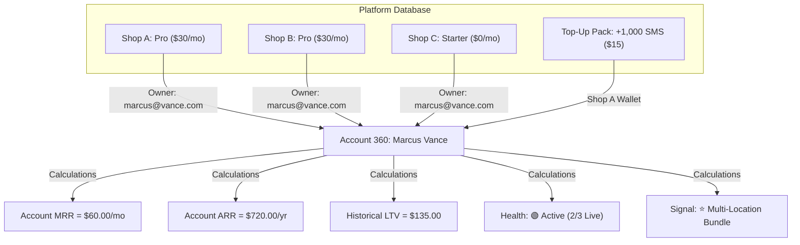

# WaitLink — SuperAdmin Revenue Metrics & Account 360° Technical Design Specification

**Document Version:** 1.0.0  
**Status:** Approved Architectural Specification  
**Target Subsystem:** SuperAdmin Platform Directory (`#superpanel-revenue`)  
**Target Roles:** Platform SuperAdmin, Founder, Operations Lead  
**Author:** DeepMind Antigravity Engineering  

---

## 1. Executive Summary & Strategic Rationale

WaitLink currently provides a **Shop-Centric** SuperAdmin directory (`#superpanel-shops`), where each row in the table represents an individual retail barbershop, salon, or healthcare clinic. 

While sufficient for low-volume tenant inventory, a shop-centric view creates major operational blind spots as the platform scales:
1. **Multi-Location Invisibility:** A single business owner operating 3 or 5 locations appears as disjointed, unrelated rows. The platform founder cannot easily identify high-value enterprise franchises.
2. **Untracked Unit Economics:** Monthly Recurring Revenue (MRR), Average Revenue Per User (ARPU), and Customer Lifetime Value (LTV) cannot be analyzed on an account level.
3. **Hidden Churn & Expansion Signals:** SuperAdmins cannot quickly discern which free Starter users are handling massive foot traffic (prime upsell targets) versus which paying Pro accounts have gone dormant (high churn risk).

### 1.1 Objective of the Revenue Metrics & Account 360° Engine
The **Revenue Metrics & Account 360°** module transforms SuperAdmin from a passive database viewer into an **active SaaS Revenue Intelligence Engine**. It delivers:
- **Macro Business Health**: Real-time platform MRR, ARR, Paid Conversion Rate, Blended ARPU, and Outbound SMS Top-Up Volume.
- **Owner-Centric Master Grid**: An aggregated view grouping all storefronts under their registered owner email account, detailing total locations, active vs. idle status, combined MRR, and growth status.
- **Interactive 360° Account Deep-Dive Drawer**: A slide-out master-detail inspection terminal breaking down each shop in an owner's portfolio, live queue throughput, SMS reserve balances, financial rollup, and founder action buttons.
- **100% Mathematical Precision**: Provably correct revenue, usage, and conversion formulas with zero room for rounding discrepancies, `NaN` errors, or division-by-zero crashes.

---

## 2. Mathematical Formulations & Revenue Calculation Invariants

All calculations in this module must strictly adhere to standard SaaS accounting principles. Below are the definitive mathematical rules enforced across the platform:



### 2.1 Pricing Tier Constant Definitions
Subscription tier prices are dynamically pulled from the live platform tier registry (`state.pricingTiers` or fallback defaults):

$$\text{Price}(\text{Starter}) = \$0.00$$
$$\text{Price}(\text{Pro}) = \$30.00 \quad (\text{or dynamic config value})$$
$$\text{Price}(\text{Enterprise}) = \$99.00 \quad (\text{or dynamic config value})$$

### 2.2 Monthly Recurring Revenue (MRR)
MRR represents the normalized monthly subscription revenue contracted from active, paying tenants:

$$\text{MRR}_{\text{shop}} = \begin{cases} 
\text{Price}(\text{tier}) & \text{if shop is active and status} \in \{\text{'active'}, \text{'trialing'}, \text{'paid'}\} \\
\$0.00 & \text{if tier is Starter or status} \in \{\text{'canceled'}, \text{'unpaid'}, \text{'delinquent'}\}
\end{cases}$$

For an individual **Account Owner** $u$ with portfolio $S_u = \{s_1, s_2, \dots, s_k\}$:

$$\text{MRR}_{\text{account}}(u) = \sum_{s \in S_u} \text{MRR}_{\text{shop}}(s)$$

For the **Entire Platform**:

$$\text{MRR}_{\text{platform}} = \sum_{u \in \text{All Accounts}} \text{MRR}_{\text{account}}(u)$$

### 2.3 Annual Recurring Revenue (ARR)
ARR standardizes monthly recurring revenue to an annual run-rate:

$$\text{ARR} = \text{MRR}_{\text{platform}} \times 12$$

### 2.4 Average Revenue Per User (ARPU) & Paying User (ARPPU)
Let $N_{\text{total}}$ be the total count of distinct registered account owners, and $N_{\text{paid}}$ be the count of account owners where $\text{MRR}_{\text{account}} > 0$.

$$\text{ARPU} = \begin{cases} 
\frac{\text{MRR}_{\text{platform}}}{N_{\text{total}}} & \text{if } N_{\text{total}} > 0 \\ 
\$0.00 & \text{if } N_{\text{total}} = 0 
\end{cases}$$

$$\text{ARPPU} = \begin{cases} 
\frac{\text{MRR}_{\text{platform}}}{N_{\text{paid}}} & \text{if } N_{\text{paid}} > 0 \\ 
\$0.00 & \text{if } N_{\text{paid}} = 0 
\end{cases}$$

*Mathematical Guard*: If $N_{\text{total}} = 0$ or $N_{\text{paid}} = 0$, the calculation returns `0` rather than `NaN` or `Infinity`.

### 2.5 Freemium Conversion Rate (FCR)
The proportion of registered shop owners who have activated at least one paid location:

$$\text{FCR} = \begin{cases} 
\left( \frac{N_{\text{paid}}}{N_{\text{total}}} \right) \times 100\% & \text{if } N_{\text{total}} > 0 \\ 
0.0\% & \text{if } N_{\text{total}} = 0 
\end{cases}$$

### 2.6 Outbound SMS Reserve Top-Up Volume & Net Margin
Top-ups are non-recurring add-on credit packs sold via Stripe (`Micro: $5`, `Growth: $15`, `Power: $39`).

$$\text{TopUpRevenue}_{\text{30d}} = \sum_{t \in \text{Top-Ups in last 30d}} \text{Price}(t)$$

$$\text{TopUpRevenue}_{\text{lifetime}} = \sum_{t \in \text{All Historical Top-Ups}} \text{Price}(t)$$

#### Unit Margin Math:
Given realized telephony gateway + carrier A2P 10DLC fees of $\$0.013$ per SMS segment:

$$\text{COGS}(t) = \text{Credits}(t) \times \$0.013$$
$$\text{Gross Profit}(t) = \text{Price}(t) - \text{COGS}(t)$$
$$\text{Realized Gross Margin } \% = \left( \frac{\sum \text{Gross Profit}}{\sum \text{TopUpRevenue}} \right) \times 100\%$$

| Top-Up Pack | Price | Credits | Realized COGS ($0.013/SMS) | Gross Profit | Gross Margin % |
| :--- | :--- | :--- | :--- | :--- | :--- |
| **Micro** | $5.00 | 250 | $3.25 | **+$1.75** | **35.0%** |
| **Growth** | $15.00 | 1,000 | $13.00 | **+$2.00** | **13.3%** |
| **Power** | $39.00 | 2,500 | $32.50 | **+$6.50** | **16.7%** |

### 2.7 Customer Lifetime Value (LTV)
For Account Owner $u$:

$$\text{Historical Realized Spend}(u) = \sum \text{Historical Subscription Invoices} + \sum \text{Purchased Top-Up Packs}$$

$$\text{Projected Forward LTV}(u) = \text{Historical Realized Spend}(u) + \left( \text{MRR}_{\text{account}}(u) \times \text{Benchmark Lifespan (24 months)} \right)$$

---

## 3. Account Health Scoring & Intelligent Growth Heuristics

To make this dashboard an active decision driver, each account is evaluated against real-time operational heuristics:

### 3.1 Account Recency & Activity State Machine
Let $T_{\text{last\_active}}$ be the latest timestamp among:
1. Most recent walk-in customer added to queue (`createdDate` or `timestamp`)
2. Most recent customer called/served (`servedAt`)
3. Most recent staff terminal login (`lastStaffLogin`)
4. Shop profile or configuration update (`updatedAt`)

$$\Delta t = \text{Current Time} - T_{\text{last\_active}}$$

| Health Status | Condition | UI Badge | System Interpretation |
| :--- | :--- | :--- | :--- |
| **Live & Active Today** | $\Delta t \le 24 \text{ hours}$ | `🟢 Active Today` | Storefront is operating live right now. |
| **Weekly Active** | $24 \text{ hours} < \Delta t \le 7 \text{ days}$ | `🔵 Active (This Week)` | Normal operational schedule (e.g., closed on Sun/Mon). |
| **At-Risk / Cooling** | $7 \text{ days} < \Delta t \le 30 \text{ days}$ | `🟡 Inactive > 7d` | Storefront has had zero check-ins for a week. |
| **Dormant / Churned** | $\Delta t > 30 \text{ days}$ or no data | `⚪ Dormant (>30d)` | Abandoned setup or merchant closed business. |

### 3.2 Actionable SuperAdmin Growth Heuristics Matrix

```
                    ┌───────────────────────────────────────────────┐
                    │       ACCOUNT EVALUATION ENGINE               │
                    └──────────────────────┬────────────────────────┘
                                           │
         ┌───────────────────┬─────────────┴───────┬───────────────────┐
         ▼                   ▼                     ▼                   ▼
  [Starter Plan +     [Owns 2+ Shops +      [Pro Plan +          [Paid Account +
   > 150 Visits/mo]    Has 1+ Starter]       > 2 Top-Ups/mo]      0 Visits in 14d]
         │                   │                     │                   │
         ▼                   ▼                     ▼                   ▼
  🔥 High-Intent      ⭐ Multi-Location     💎 Enterprise        ⚠️ Churn Risk
  Upsell to Pro       Expansion Bundle      High-Volume Add-On   Outreach Needed
```

| Signal Badge | Detection Logic | Recommended Founder / Admin Action |
| :--- | :--- | :--- |
| **🔥 High-Intent Upsell** | Owner is on **Starter ($0)** and has **$\ge 150$ customer check-ins** in 30 days OR has attempted to trigger outbound SMS alerts. | Send Founder Email offering a 14-day Pro trial with customized window poster. |
| **⭐ Multi-Location Expansion** | Owner has **$\ge 2$ total shops**, with at least one on Starter and at least one on Pro. | Pitch the **Enterprise Multi-Location Bundle ($99/mo for up to 5 locations)**. |
| **💎 Enterprise Heavyweight** | Owner has consumed **$> 80\%$** of monthly SMS allowance or purchased **$\ge 2$ Top-Up packs** within 60 days. | Offer annual Enterprise contract with high custom SMS allocation (5,000 SMS/mo). |
| **⚠️ Churn Risk Alert** | Owner is paying for **Pro or Enterprise ($\ge \$30/\text{mo}$)**, but all shops have had **$0$ check-ins in the last 14 days**. | High-priority founder check-in: Merchant might have iPad connectivity or staff training issues. |
| **✅ Steady Tenant** | Regular active usage, healthy balance, no payment failures. | Normal state; maintain service reliability. |

---

## 4. UI Architecture & Master-Detail Component Hierarchy

### 4.1 Sub-Tab Navigation Wiring
In `index.html`, under the SuperAdmin view (`#view-superadmin`), the sub-tab navigation bar is extended with the new tab:

```html
<div class="mode-tabs" style="margin-bottom: 1.5rem;">
  <button class="tab-btn" id="supertab-shops" onclick="switchSuperTab('shops')">
    🏢 Master Shops Directory
  </button>
  <button class="tab-btn active" id="supertab-revenue" onclick="switchSuperTab('revenue')">
    📊 Revenue Metrics & Account 360°
  </button>
  <button class="tab-btn" id="supertab-pricing" onclick="switchSuperTab('pricing')">
    💎 Pricing Config & Tiers
  </button>
  <button class="tab-btn" id="supertab-support" onclick="switchSuperTab('support')">
    📩 Support Inquiries Inbox
  </button>
  <button class="tab-btn" id="supertab-retention" onclick="switchSuperTab('retention')">
    🛡️ Data Retention & Privacy
  </button>
</div>
```

### 4.2 Top Macro Scorecard Row
Directly beneath the header of `#superpanel-revenue`:

```
┌─────────────────────────┬─────────────────────────┬─────────────────────────┬─────────────────────────┐
│  💵 TOTAL PLATFORM MRR  │  📈 CONVERSION RATE     │  👥 BLENDED ARPU        │  ⚡ 30D TOP-UP VOLUME   │
│      $1,260.00 / mo     │         28.6%           │      $35.00 / acct      │       $180.00           │
│  ARR: $15,120.00 / yr   │   12 Paid / 42 Owners   │   $105.00 / paid acct   │   12,000 SMS Purchased  │
└─────────────────────────┴─────────────────────────┴─────────────────────────┴─────────────────────────┘
```

### 4.3 Interactive Search & Filter Toolbar
Allows the SuperAdmin to instantly segment accounts:
- **Search Bar**: Real-time filtering by owner email, owner name, or shop title.
- **Filter: Plan Tier**: `All Tiers`, `Paid Only (Pro / Enterprise)`, `Free Starter Only`.
- **Filter: Location Count**: `All Sizes`, `Single-Store (1)`, `Multi-Unit (2+)`.
- **Filter: Growth Signal**: `All Signals`, `🔥 Upsell Candidate`, `⭐ Multi-Location`, `⚠️ Churn Risk`.
- **Sorting Dropdown**: `Sort by MRR (High to Low)`, `Sort by Total Shops`, `Sort by 30d Check-ins`, `Sort by Most Recent Activity`.

### 4.4 Master Accounts Grid Table
Each row represents a unified **Account Owner**:

```
┌────────────────────────────────────────────────────────────────────────────────────────────────────────┐
│ REGISTERED OWNER         TOTAL SHOPS      SUBSCRIPTION STATUS     MONTHLY MRR   30D VISITS   GROWTH SIGNAL    ACTION   │
├────────────────────────────────────────────────────────────────────────────────────────────────────────┤
│ marcus@vancegrooming.com 3 Shops (2 🟢/1 ⚪) Pro ($30) + Pro ($30)  $60.00 / mo   920 visits   ⭐ Multi-Unit   [ 🔍 360° ]│
│ elena@apexurgentcare.com 1 Shop  (1 🟢)   Enterprise ($99)        $99.00 / mo   1,450 visits 💎 High-Volume  [ 🔍 360° ]│
│ tony@tonyscuts.com       1 Shop  (1 🟢)   Starter ($0)            $0.00 / mo    380 visits   🔥 Ready Upsell [ 🔍 360° ]│
│ david@metrobarbers.com   2 Shops (0 🟢/2 🔴) Pro ($30) + Starter ($0)$30.00 / mo    0 visits     ⚠️ Churn Risk   [ 🔍 360° ]│
└────────────────────────────────────────────────────────────────────────────────────────────────────────┘
```

### 4.5 The Account 360° Slide-Out Drawer (`#account-360-drawer`)
When `[ 🔍 360° ]` is clicked, a 540px right-side drawer slides in over the page with backdrop blur:

```
┌──────────────────────────────────────────────────────────────────┐
│ [✕] CLOSE               ACCOUNT 360° PROFILE                     │
├──────────────────────────────────────────────────────────────────┤
│ 👤 Marcus Vance                                                  │
│ ✉️ marcus@vancegrooming.com • 📅 Tenant Since: Feb 14, 2026       │
│ 💳 Stripe ID: cus_R8xL1940aB • 🛡️ Auth: Verified Email          │
├──────────────────────────────────────────────────────────────────┤
│ 🏬 SHOP LOCATIONS (3 Total • 2 Live Active)                       │
│                                                                  │
│  💈 Vance Grooming — Downtown                                    │
│     Slug: vance-downtown • Tier: Pro Business ($30/mo)           │
│     Status: 🟢 Live Today • 30d Foot Traffic: 580 check-ins       │
│     SMS Quota: 412 / 500 Used (82%) • Reserve: +1,000 SMS       │
│     Links: [Front Desk ↗] [Public Check-in ↗] [Config ↗]         │
│                                                                  │
│  💈 Vance Grooming — Uptown                                      │
│     Slug: vance-uptown • Tier: Pro Business ($30/mo)             │
│     Status: 🟢 Live Today • 30d Foot Traffic: 340 check-ins       │
│     SMS Quota: 210 / 500 Used (42%) • Reserve: 0 SMS             │
│     Links: [Front Desk ↗] [Public Check-in ↗] [Config ↗]         │
│                                                                  │
│  💈 Vance Grooming — West End (Opening Soon)                     │
│     Slug: vance-west-end • Tier: Starter ($0/mo)                 │
│     Status: ⚪ Setup Mode (0 check-ins)                           │
│     Links: [Front Desk ↗] [Public Check-in ↗] [Config ↗]         │
├──────────────────────────────────────────────────────────────────┤
│ 💰 FINANCIAL & VALUE ROLLUP                                      │
│  • Base Monthly SaaS Run-Rate:         $60.00 / mo               │
│  • Annualized Value (ARR):             $720.00 / yr              │
│  • Outbound SMS Top-Ups (Lifetime):    $30.00 (2x Growth Packs)  │
│  • Total Realized Spend (LTV to Date): $150.00                   │
│  • Projected 24-Month LTV:             $1,590.00                 │
├──────────────────────────────────────────────────────────────────┤
│ ⚡ SUPERADMIN FOUNDER ACTIONS                                     │
│  [🔑 Impersonate / Jump to Desk]    [✉️ Email Owner Direct]      │
│  [🎁 Grant 250 Courtesy SMS]         [💎 Upgrade to Enterprise]  │
└──────────────────────────────────────────────────────────────────┘
```

---

## 5. Data Flow & Aggregation Architecture

### 5.1 Zero Redundant Reads: In-Memory Aggregation Pipeline
To eliminate unnecessary Cloud Firestore query costs and prevent rate-limiting, the Revenue Metrics engine aggregates data directly from the already-cached SuperAdmin directory list (`state.superadminShops`):

```javascript
/**
 * Universal Account Record Data Contract
 */
interface AccountRecord {
  ownerEmail: string;
  ownerDisplayName: string;
  memberSince: Date | string;
  shops: Array<{
    shopSlug: string;
    shopName: string;
    tier: "starter" | "pro" | "enterprise";
    monthlyPrice: number;
    status: "active" | "inactive" | "setup";
    totalCheckIns30d: number;
    lastActiveTimestamp: number;
    smsAllowance: number;
    smsUsed: number;
    topUpBalance: number;
  }>;
  totalShopsCount: number;
  activeShopsCount: number;
  accountMrr: number;
  accountArr: number;
  historicalSpend: number;
  healthStatus: "active_today" | "active_week" | "at_risk" | "dormant";
  growthSignal: "upsell_candidate" | "multi_location" | "enterprise_ready" | "churn_risk" | "steady";
}
```

### 5.2 Aggregation Execution Algorithm
```javascript
function aggregateRevenueAccounts(shopsList, pricingTiers) {
  const accountsMap = new Map();
  const tierPriceMap = {
    starter: 0,
    pro: (pricingTiers && pricingTiers.pro && pricingTiers.pro.price) || 30,
    enterprise: (pricingTiers && pricingTiers.enterprise && pricingTiers.enterprise.price) || 99
  };

  const now = Date.now();
  const ONE_DAY = 24 * 60 * 60 * 1000;
  const SEVEN_DAYS = 7 * ONE_DAY;
  const THIRTY_DAYS = 30 * ONE_DAY;

  shopsList.forEach(shop => {
    const rawEmail = (shop.ownerEmail || shop.email || "unassigned@waitlink.app").trim().toLowerCase();
    if (!accountsMap.has(rawEmail)) {
      accountsMap.set(rawEmail, {
        ownerEmail: rawEmail,
        ownerDisplayName: shop.ownerName || rawEmail.split("@")[0],
        memberSince: shop.createdAt || shop.createdDate || new Date().toISOString(),
        shops: [],
        totalShopsCount: 0,
        activeShopsCount: 0,
        accountMrr: 0,
        accountArr: 0,
        historicalSpend: 0,
        totalVisits30d: 0,
        mostRecentActivityMs: 0
      });
    }

    const acct = accountsMap.get(rawEmail);
    const tier = (shop.tier || (shop.isPaid ? "pro" : "starter")).toLowerCase();
    const isShopActive = shop.isActive !== false && shop.status !== "inactive";
    const monthlyRate = isShopActive ? (tierPriceMap[tier] || 0) : 0;
    const visits30d = Number(shop.totalCheckIns30d || shop.totalServed || 0);

    const activityMs = shop.lastActiveAt ? new Date(shop.lastActiveAt).getTime() : 
                       (shop.updatedAt ? new Date(shop.updatedAt).getTime() : 0);

    acct.shops.push({
      shopSlug: shop.slug || shop.id,
      shopName: shop.shopName || shop.name || "Untitled Shop",
      tier: tier,
      monthlyPrice: monthlyRate,
      status: isShopActive ? "active" : "inactive",
      totalCheckIns30d: visits30d,
      lastActiveTimestamp: activityMs,
      smsAllowance: shop.monthlyQuota || 500,
      smsUsed: shop.smsUsedMonth || 0,
      topUpBalance: shop.topUpBalance || 0
    });

    acct.totalShopsCount += 1;
    if (isShopActive) acct.activeShopsCount += 1;
    acct.accountMrr += monthlyRate;
    acct.totalVisits30d += visits30d;
    if (activityMs > acct.mostRecentActivityMs) {
      acct.mostRecentActivityMs = activityMs;
    }
  });

  // Second pass: Compute macro derivatives, health statuses, and growth signals
  const result = [];
  accountsMap.forEach(acct => {
    acct.accountArr = acct.accountMrr * 12;
    
    // Compute Activity Health
    const deltaMs = now - acct.mostRecentActivityMs;
    if (acct.mostRecentActivityMs === 0 || deltaMs > THIRTY_DAYS) {
      acct.healthStatus = "dormant";
    } else if (deltaMs > SEVEN_DAYS) {
      acct.healthStatus = "at_risk";
    } else if (deltaMs > ONE_DAY) {
      acct.healthStatus = "active_week";
    } else {
      acct.healthStatus = "active_today";
    }

    // Compute Growth / Churn Signal
    const hasStarter = acct.shops.some(s => s.tier === "starter");
    const hasPaid = acct.shops.some(s => s.tier === "pro" || s.tier === "enterprise");

    if (acct.accountMrr > 0 && acct.healthStatus === "at_risk" && acct.totalVisits30d === 0) {
      acct.growthSignal = "churn_risk";
    } else if (acct.totalShopsCount >= 2 && hasStarter) {
      acct.growthSignal = "multi_location";
    } else if (!hasPaid && acct.totalVisits30d >= 150) {
      acct.growthSignal = "upsell_candidate";
    } else if (acct.shops.some(s => s.smsUsed >= s.smsAllowance * 0.8 || s.topUpBalance > 0)) {
      acct.growthSignal = "enterprise_ready";
    } else {
      acct.growthSignal = "steady";
    }

    result.push(acct);
  });

  return result;
}
```

---

## 6. Security, Authorization & Tenancy Boundaries

1. **Strict Role-Based Gate (`role === "superadmin"`)**:
   - Access to `#supertab-revenue` and execution of `aggregateRevenueAccounts()` is restricted exclusively to authenticated SuperAdmins.
   - If an unauthenticated guest or standard front desk staff member attempts to trigger the revenue tab via URL hash or script injection (`switchSuperTab('revenue')`), the request is immediately rejected with a redirect to `#superpanel-shops` or login modal.
2. **PII Masking Protection**:
   - Customer phone numbers and patient names within individual queue items are never aggregated or displayed in this view; only numerical volume counts and business owner emails are shown.
3. **Fail-Safe Currency Formatter**:
   - Every financial number is passed through `formatCurrencyUsd(amount)`:
   ```javascript
   function formatCurrencyUsd(amount) {
     const num = Number(amount);
     if (isNaN(num) || !isFinite(num)) return "$0.00";
     return new Intl.NumberFormat("en-US", { style: "currency", currency: "USD" }).format(num);
   }
   ```

---

## 7. Implementation Checklist & Phase Roadmap

- [ ] **Phase 1: DOM Markup & UI Containers**
  - Add `#supertab-revenue` button in `index.html`.
  - Add `#superpanel-revenue` container with KPI scorecards, filter bar, and accounts table.
  - Add `#account-360-drawer` slide-out container with backdrop.
- [ ] **Phase 2: Core Analytics & Aggregation Engine**
  - Implement `formatCurrencyUsd()`, `aggregateRevenueAccounts()`, and health heuristics in `app.js`.
  - Add `renderSuperAdminRevenuePanel()` with reactive filters and sorting.
- [ ] **Phase 3: 360° Account Deep-Dive Drawer**
  - Implement `openAccount360Drawer(ownerEmail)` and `closeAccount360Drawer()`.
  - Wire action buttons: Jump to Desk, Email Owner, Grant Courtesy SMS, Change Tier.
- [ ] **Phase 4: Responsive CSS & Styling**
  - Implement glassmorphism table styles, slide-out drawer transition animations, and dark/light mode contrast rules in `style.css`.
- [ ] **Phase 5: Automated Testing Quality Gate**
  - Add dedicated test suite `tests/test_superadmin_revenue_metrics.js` verifying 100% mathematical accuracy of MRR, ARR, ARPU, FCR, and growth signal heuristics.
  - Add DOM element integrity tests in `tests/test_dom_and_ui_integrity.js`.
  - Run all 7 test suites to ensure 100% pass rate.
- [ ] **Phase 6: Deployment & Verification**
  - Deploy to Firebase Hosting (`waitlink.app` and `waitlink-app-8821.web.app`).
  - Prune older hosting versions to 5.
  - Verify live in browser subagent.
