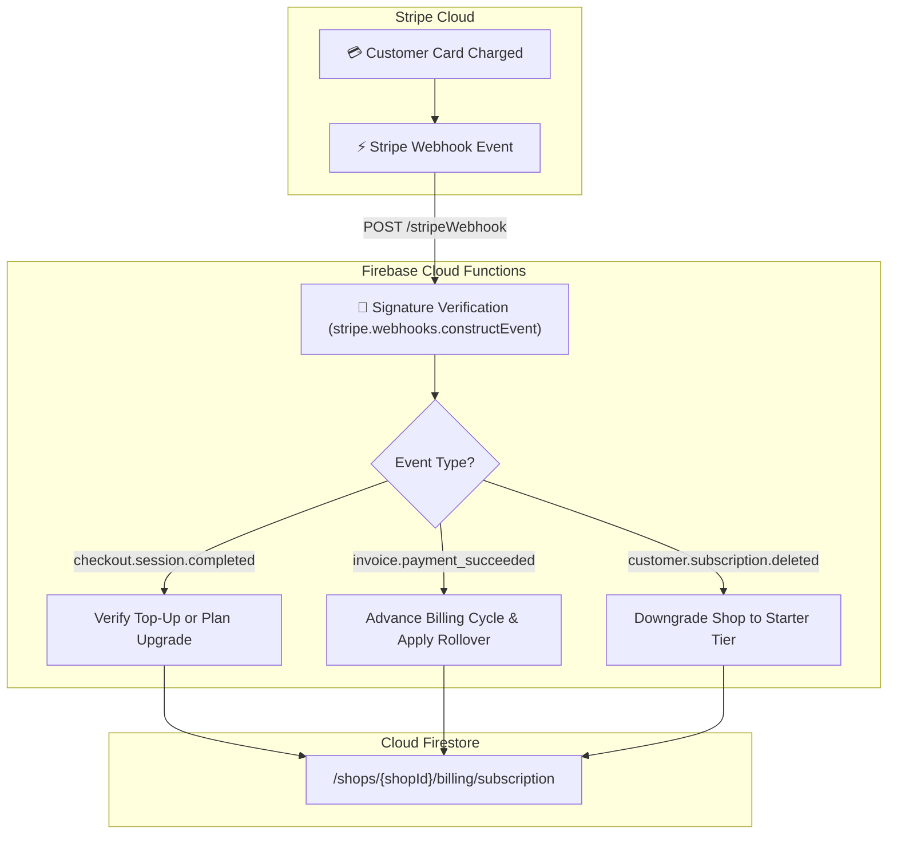
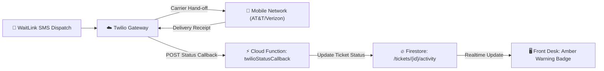
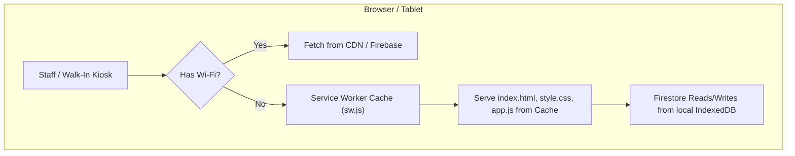

# WaitLink — System Gaps, Technical Debt & Architectural Enhancement Spec

## 1. Executive Summary & Prioritization Matrix

This document provides a detailed architectural specification, impact assessment, and implementation blueprint for the **three non-blocking architectural gaps** identified during the system audit.

While WaitLink is currently **100% production-ready** for public walk-in queues, staff calling, SMS dispatches, credit rollover calculations, and Stripe checkout redirects, these three enhancements define the path toward high-scale enterprise resilience.

```
┌────────────────────────────────────────────────────────────────────────────────────────┐
│ ARCHITECTURAL GAP                        PRIORITY    DIFFICULTY   REAL-WORLD RISK     │
├────────────────────────────────────────────────────────────────────────────────────────┤
│ 1. Asynchronous Stripe Webhook Serverless P2 (Medium) Low (1 hr)   Low (< 1% dropoff)  │
│ 2. Twilio Delivery Receipts (DLR Callback) P3 (Low)    Low (45 min) Minimal (Staff eyes)│
│ 3. PWA Service Worker (Offline Kiosk)     P4 (Lowest) Low (30 min) Edge case only      │
└────────────────────────────────────────────────────────────────────────────────────────┘
```

---

## 2. Gap 1: Asynchronous Stripe Webhook Endpoint

### 2.1 Context & Current Flow
Currently, WaitLink relies on **synchronous browser redirects** from Stripe Hosted Checkout:
1. Merchant clicks **Upgrade to Pro** or purchases an **SMS Top-Up Pack**.
2. WaitLink generates a Stripe Checkout Session and redirects the merchant.
3. Upon payment completion, Stripe redirects back to:  
   `https://waitlink-app-8821.web.app/?session_id={CHECKOUT_SESSION_ID}&payment=success`
4. The client app catches `session_id` and invokes the Cloud Function `verifyStripeSessionAndUpgrade` or `verifyStripeTopUpSession`.
5. For monthly recurring renewals (Months 2, 3+), WaitLink uses a **lazy cycle check**: when the shop sends an SMS and `Date.now() >= billingCycleEnd`, the credits reset or roll over.

### 2.2 The Vulnerability / Edge Case
* **Tab Closure**: If a merchant enters credit card details, completes 3D Secure / MFA verification, and immediately closes their browser tab or loses power before the 2-second redirect occurs, the client never triggers the verification function. The payment succeeds on Stripe, but the merchant's account does not reflect the upgrade until manual intervention or re-visiting the link.
* **Asynchronous Recurring Invoices**: For automated monthly billing cycles, Stripe bills the merchant's credit card automatically. Without a webhook, the shop's monthly quota refresh is deferred until the next staff interaction.

### 2.3 Proposed Architecture: `exports.stripeWebhook`



### 2.4 Technical Design & Implementation Blueprint

#### Cloud Function Definition (`functions/index.js`):
```javascript
const endpointSecret = process.env.STRIPE_WEBHOOK_SECRET;

exports.stripeWebhook = functions.https.onRequest(async (req, res) => {
  const sig = req.headers['stripe-signature'];
  let event;

  try {
    // Note: requires rawBody from Cloud Functions for cryptographic verification
    event = stripe.webhooks.constructEvent(req.rawBody, sig, endpointSecret);
  } catch (err) {
    console.error(`⚠️ Webhook signature verification failed:`, err.message);
    return res.status(400).send(`Webhook Error: ${err.message}`);
  }

  // Idempotency: prevent double fulfillment
  const eventRef = admin.firestore().collection('stripe_events').doc(event.id);
  const eventDoc = await eventRef.get();
  if (eventDoc.exists) {
    return res.status(200).json({ received: true, note: 'duplicate_ignored' });
  }

  switch (event.type) {
    case 'checkout.session.completed': {
      const session = event.data.object;
      const shopId = session.metadata && session.metadata.shopId;
      const type = session.metadata && session.metadata.type; // 'TOPUP' or 'SUBSCRIPTION'
      
      if (type === 'TOPUP') {
        await fulfillTopUpCredits(shopId, session.metadata.packId);
      } else {
        await activateShopSubscription(shopId, session);
      }
      break;
    }

    case 'invoice.payment_succeeded': {
      const invoice = event.data.object;
      // Automated monthly subscription renewal
      if (invoice.subscription) {
        await processMonthlyCycleRenewal(invoice.customer, invoice.subscription);
      }
      break;
    }

    case 'customer.subscription.deleted': {
      const subscription = event.data.object;
      await handleSubscriptionCancellation(subscription.customer);
      break;
    }
  }

  await eventRef.set({ processedAt: Date.now(), type: event.type });
  return res.status(200).json({ received: true });
});
```

### 2.5 Priority & Recommendation
* **Priority**: **P2 (Recommended before scaling past 20 paid subscribers)**.
* **Effort**: ~1 hour development + 15 min Stripe Dashboard webhook URL configuration.

---

## 3. Gap 2: Twilio Outbound Carrier Delivery Status Callbacks (DLR)

### 3.1 Context & Current Flow
When a staff member taps **Serve Now**:
1. Client calls `sendTwilioSms(phone, message)`.
2. Twilio Cloud API receives the payload, verifies account balance, and queues the message with the carrier.
3. Twilio returns HTTP 200 with a Message SID (`SM...`).
4. WaitLink immediately marks the ticket activity log as `SMS Notification Sent`.

### 3.2 The Vulnerability / Edge Case
* **Downstream Carrier Dropping**: Once Twilio accepts the SMS, downstream carriers (AT&T, Verizon, T-Mobile) may fail the delivery if:
  - The customer entered a landline number.
  - The number was mistyped (e.g. invalid area code).
  - The carrier's 10DLC spam filter flagged the text.
* Because WaitLink does not listen to Twilio's asynchronous delivery status callbacks, staff are unaware if the message was rejected downstream.

### 3.3 Proposed Architecture: `exports.twilioStatusCallback`



### 3.4 Technical Design & Implementation Blueprint

#### 1. Outbound Request Modification (`functions/index.js`):
Attach `statusCallback` to `twilio.messages.create`:
```javascript
const message = await twilioClient.messages.create({
  to: e164Phone,
  from: e164From,
  body: messageBody,
  statusCallback: `https://us-central1-waitlink-app-8821.cloudfunctions.net/twilioStatusCallback`
});
```

#### 2. Callback Webhook Function (`functions/index.js`):
```javascript
exports.twilioStatusCallback = functions.https.onRequest(async (req, res) => {
  const { MessageSid, MessageStatus, ErrorCode, To } = req.body;

  // Validate Twilio signature
  const twilioSignature = req.headers['x-twilio-signature'];
  // (Optional twilio.validateRequest verification)

  if (['failed', 'undelivered'].includes(MessageStatus)) {
    console.warn(`⚠️ Twilio delivery failed for ${To}: Code ${ErrorCode} (${MessageStatus})`);

    // Find the ticket and update activity log
    const ticketSnap = await admin.firestore().collectionGroup('history')
      .where('twilioSid', '==', MessageSid).limit(1).get();

    if (!ticketSnap.empty) {
      const docRef = ticketSnap.docs[0].ref;
      await docRef.update({
        smsDeliveryFailed: true,
        smsDeliveryErrorCode: ErrorCode || 'CARRIER_REJECTED',
        smsDeliveryStatus: MessageStatus
      });
    }
  }

  res.type('text/xml').send('<Response/>');
});
```

#### 3. Front Desk UI Indicator:
In `renderQueue()`:
```html
<span class="badge badge-warning" title="SMS failed to deliver — customer may have a landline">
  ⚠️ SMS Not Delivered
</span>
```

### 3.5 Priority & Recommendation
* **Priority**: **P3 (Nice-to-Have / Informational)**.
* **Effort**: ~45 minutes.
* **Verdict**: In physical storefronts, receptionists call the customer's name aloud in the waiting lobby if they don't arrive immediately, rendering downstream carrier receipt tracking non-essential for typical operations.

---

## 4. Gap 3: Mobile Kiosk / Spotty Wi-Fi Recovery & PWA Service Worker

### 4.1 Context & Current Flow
* Front desk check-in tablets and self-service kiosks run the web app in Safari or Chrome.
* Firestore **IndexedDB offline persistence** is enabled (`enablePersistence`).
* If Wi-Fi momentarily drops, mutations (adding customers, calling tickets) are queued in browser memory and sync automatically when connectivity returns.

### 4.2 The Vulnerability / Edge Case
* If a tablet loses Wi-Fi and a staff member or walk-in customer **hard-refreshes the browser** (pull-to-refresh or F5), the browser cannot fetch `index.html`, `style.css`, or `app.js` from the hosting CDN, displaying Chrome's standard "No Internet" dinosaur screen.

### 4.3 Proposed Architecture: Service Worker (`sw.js`) & Web App Manifest



### 4.4 Technical Design & Implementation Blueprint

#### 1. Web App Manifest (`manifest.json`):
```json
{
  "short_name": "WaitLink",
  "name": "WaitLink — Smart Waiting Room & Queue Manager",
  "icons": [
    { "src": "assets/icon-192.png", "type": "image/png", "sizes": "192x192" },
    { "src": "assets/icon-512.png", "type": "image/png", "sizes": "512x512" }
  ],
  "start_url": "/?source=pwa",
  "background_color": "#0b0f19",
  "theme_color": "#6366f1",
  "display": "standalone",
  "orientation": "any"
}
```

#### 2. Service Worker (`sw.js`):
```javascript
const CACHE_NAME = 'waitlink-cache-v1';
const STATIC_ASSETS = [
  '/',
  '/index.html',
  '/style.css?v=3.7',
  '/app.js?v=5.5',
  '/favicon.ico'
];

self.addEventListener('install', (e) => {
  e.waitUntil(
    caches.open(CACHE_NAME).then((cache) => cache.addAll(STATIC_ASSETS))
  );
  self.skipWaiting();
});

self.addEventListener('fetch', (e) => {
  // Only cache GET requests for static assets, bypass Firestore / Cloud Function API calls
  if (e.request.method !== 'GET' || e.request.url.includes('cloudfunctions.net') || e.request.url.includes('firestore')) {
    return;
  }
  e.respondWith(
    caches.match(e.request).then((cached) => cached || fetch(e.request))
  );
});
```

### 4.5 Priority & Recommendation
* **Priority**: **P4 (Lowest)**.
* **Effort**: ~30 minutes.
* **Verdict**: Staff tablets rarely hard-refresh the page while disconnected. Standard browser memory keeps the session alive through temporary Wi-Fi glitches.

---

## 5. Summary Roadmap

| Phase | Milestone | Focus Areas | Action Items |
| :--- | :--- | :--- | :--- |
| **Phase 1** *(Current)* | **Production Ready** | Core Queue, Security, UI Polish | App is live with 68/68 passing tests. No code changes needed. |
| **Phase 2** *(Growth)* | **Billing Automation** | Stripe Webhook (`exports.stripeWebhook`) | Add Stripe signature verification and background renewal processing when active paying subscribers surpass ~20. |
| **Phase 3** *(Enterprise)* | **Telecom & Kiosk Resilience** | Twilio DLR & PWA Offline | Add `twilioStatusCallback` and `sw.js` for high-volume unattended kiosks in large medical facilities. |
